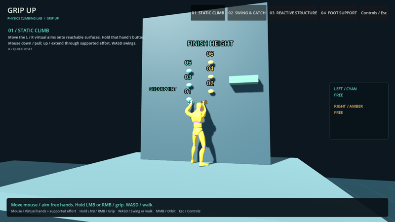

# GRIP UP · physics climbing lab

A Godot 4.7 prototype about climbing with your hands. Each mouse button is one hand: hold it to grip, let go to release. The body is a simulated rigid body on Jolt physics at 120 Hz. Arms pull with finite tension, so swings, lowering and charged launches come from the physics rather than from canned animations.

## What's in it

- **Two independent hands**, each with its own grip, reach and release, mapped to the left and right mouse buttons
- **Physical climbing:** contract the arms to pull up, extend to lower, swing on one hand, then load the arms and launch to catch a higher hold
- **Biped character:** a CC0 Quaternius mannequin with a render-only arm and leg IK rig on top of one simulated body, plus ground walking when both hands are free
- **Courses:** a static climb, swing-and-catch, reactive structures, foot support and a full greybox ascent
- **Auto-tuning lab:** an offline Python and Optuna tool that compares controller parameters on declared physics tasks; it is kept outside the game build
- **Tooling:** control remapping with conflict checks, physics diagnostics overlay and validation reports for every milestone

## Branches

`main` holds the first playable version (0.1). Development continues on the `feature/v1.x` branches; the newest one has the latest courses, controls and the tuning lab.

## Run

Open `project.godot` in Godot 4.7.2 and press F5. PC, mouse and keyboard.

| Input | Action |
|---|---|
| Hold left / right mouse button | Grip with the cyan / amber hand |
| W / S while gripping | Pull up / lower |
| A / D while gripping | Swing left / right |
| Hold and release Space | Load the arms, then launch |
| WASD with free hands | Walk |
| Middle mouse / wheel | Orbit / zoom |
| R | Retry from checkpoint |

Character: [Quaternius](https://quaternius.com) mannequin (CC0).
