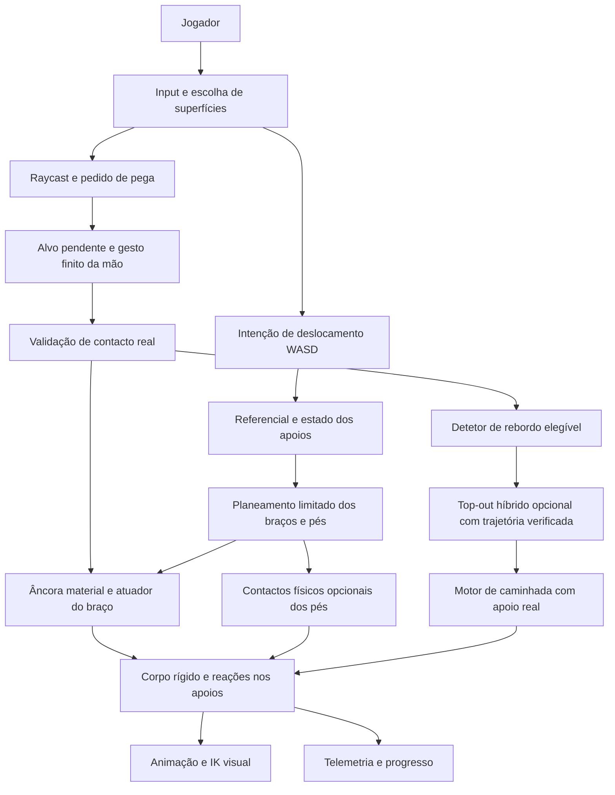

# GRIP UP relatório do sistema implementado antes do M7

Data: 20 de outubro de 2026. Referência do código: commit `d4fcaec07e050593236fc5f81ff5ca51f3b0576f`, branch `feature/v1.0-contextual-vault`, repositório `wynterCG/grip_up`.

## Estado geral

O GRIP UP permite controlar um bípede no chão, escolher contactos livres para cada mão, subir através de apoios reais, atravessar, ficar suspenso e gerar balanço. As mãos e os pés opcionais transmitem forças limitadas ao mesmo corpo rígido. Os objetos dinâmicos recebem as reações correspondentes. O modelo visual acompanha o corpo através de animação e cinemática inversa, ou IK.

O perfil de intenção v0.7 separa a escolha das pegas da deslocação do corpo: o rato escolhe os contactos e WASD pede deslocamento em relação ao apoio. Esse perfil está implementado, mas a comparação humana prevista na spec v0.7 permanece incompleta. O feedback positivo do designer sustenta continuar; não encerra todos os critérios de controlo, conforto e expressão de habilidade.

Já existe uma chegada funcional ao topo, seguida de caminhada. **Essa chegada usa a solução híbrida das versões v0.9 e v1.0.** Durante uma transição curta, um motor cinemático conduz o corpo por uma trajetória verificada contra colisões. A escalada normal continua dinâmica. O mantle integralmente produzido por forças, investigado na v0.7.4 e na v0.8, não conseguiu completar a passagem para o chão superior.

O percurso mais recente, **The First Ascent**, combina subida, travessia, suspensão, nova subida e top-out híbrido. É um percurso estático de ensaio. **O desafio reativo M7 ainda não foi implementado.** A viga articulada existente é um laboratório de física, não o nível com viga e contrapeso que deverá abrir uma nova passagem.

| Área | Estado atual |
|---|---|
| Caminhada third-person | Implementada no mesmo corpo rígido da escalada |
| Duas mãos independentes e hold-to-grip | Implementados |
| Contactos livres em superfícies elegíveis | Implementados; não dependem das marcas pintadas |
| Seleção antecipada fora de alcance | Implementada como opção; uma seleção pendente não faz força |
| Contacto máximo numa superfície próxima | Implementado no perfil 4 com a opção de alvos distantes ativa |
| Locomoção por intenção v0.7 | Implementada como perfil 4 opcional |
| Balanço apoiado e controlo com uma mão | Implementados com autoridade limitada; conforto ainda por comparar |
| Pés físicos | Implementados como experiência explícita |
| Pernas passivas e acopladas visualmente | Implementadas; não constituem um ragdoll |
| Palmas compressivas e colisão inferior adaptativa v0.8 | Capacidades isoladas implementadas; sequência física completa falhou |
| Top-out híbrido v0.9 | Funcional nos cenários estáticos testados |
| Apresentação de vault v1.0 | Um estilo refinado implementado; sem classificador contextual |
| The First Ascent | Implementado e percorrido automaticamente a 60 e 120 Hz |
| Avaliação humana completa M5 da v0.7 | Parcial |
| Desafio reativo M7 da v0.7 | Por fazer |

## Projeto e execução

| Elemento | Configuração |
|---|---|
| Pasta principal | `E:\Godot Games\grip_up` |
| Espelho de trabalho | `C:\Users\Wynter\grip_up` |
| Motor usado nas verificações arquivadas | Godot 4.7.2, GDScript, Jolt integrado |
| Cena de entrada | `features/grip_up/scenes/grip_up_lab.tscn` |
| Frequência física padrão | 120 Hz |
| Frequência de comparação | 60 Hz |
| Interpolação física | Ativa |
| Passos físicos máximos por frame | 16 |
| Renderização | GL Compatibility, MSAA 2× |
| Plataforma de trabalho | Windows PC, rato e teclado |
| Canvas de referência | 1920 × 1080 |
| Janela inicial | 1440 × 810, redimensionável |
| Tamanho mínimo da janela do jogo | 1024 × 576 |
| Adaptação da apresentação | `canvas_items`, aspeto `expand` |
| Executável mais recente | `builds/GripUp-v1.0-experimental.exe` |
| Integração com o editor | Godot MCP Pro, instalado localmente |

O projeto e o grabber originais de Janga permanecem separados. O GRIP UP adapta a família de servo físico de Janga para atuadores de braços, mas não modifica o `physics_grabber.gd` original.

O arranque normal continua no **perfil contextual 2**, com pés físicos e experiências posteriores desligados. Os botões de laboratório selecionam condições específicas. Uma sessão deixada no First Ascent não significa que o arranque do projeto tenha sido promovido para esse modo.

## Arquitetura e autoridade sobre o corpo

`grip_up_lab.gd` integra input, cenários, UI, câmara e observação de progresso. `climbing_controller.gd` coordena pegas, atuadores, pés e orçamentos. A locomoção por intenção planeia alvos; não substitui o cálculo físico das forças.



Existem duas autoridades de movimento distintas:

1. **Movimento normal:** o corpo responde a gravidade, contacto, fricção, forças dos braços/pés e motores limitados de caminhada e balanço.
2. **Top-out híbrido comprometido:** o controlador retira a autoridade dos motores normais, liberta as pegas físicas e passa temporariamente para movimento cinemático verificado. A física dinâmica regressa depois de restaurar a configuração de pé e confirmar apoio superior real.

Durante essa transição assistida, não se devem interpretar os valores nulos dos atuadores como uma subida puramente física. Também não se devem aplicar os 360 N dos braços por cima da trajetória cinemática.

## Corpo físico e anatomia

O personagem usa **um único `RigidBody3D` de 12 kg** com colisores compostos. Os braços e as pernas não são uma cadeia de corpos rígidos com massa e articulações individuais. As extremidades dos atuadores são virtuais; os ossos representam visualmente o resultado.

O corpo tem CCD, não adormece e usa centro de massa personalizado na origem pélvica. A orientação permanece dinâmica. A assistência angular é limitada; não congela permanentemente o corpo durante a escalada normal.

Os parâmetros efetivos vêm de `biped_tuning.gd`. Os valores genéricos de `climbing_tuning.gd`, como um braço de 2,35 m, são substituídos pelo perfil do bípede e não representam o alcance usado no jogo.

| Grandeza efetiva | Valor |
|---|---:|
| Massa | 12 kg |
| Fricção do corpo | 0,12 |
| Amortecimento linear próprio | 0,08, combinado com o mundo |
| Amortecimento angular próprio | 0,35, combinado com o mundo |
| Ombros locais | X = ±0,1919 m; Y = 0,5241 m; Z = 0,0153 m |
| Comprimento medido ombro–pulso | Aproximadamente 0,54708 m |
| Extensão da palma | 0,11 m |
| Alcance anatómico ombro–contacto | Aproximadamente 0,65708 m |
| Comprimento de repouso do atuador | 0,18–0,62 m |
| Margem elástica | 0,04 m |
| Rigidez axial | 6000 N/m |
| Amortecimento axial | 220 N·s/m |
| Erro máximo usado pela mola | 0,12 m |
| Velocidade máxima do gesto da mão | 4 m/s no referencial do ombro no alcance persistente |
| Blend inicial de aquisição | 0,10 s |
| Resposta da distribuição entre mãos | 0,14 s |

Alcance anatómico e comprimento de repouso são diferentes. A mão pode contactar na extensão anatómica máxima, mas o atuador continua limitado a 0,62 m de repouso. Uma captura no limite pode criar pré-carga e perder-se quando o corpo se afasta. Esticar completamente não garante capacidade de conservar a pega ou de subir.

O corpo normal tem cápsula de tronco, cabeça, cápsula inferior e uma sola `FootBase`. A v0.8 e o motor híbrido acrescentam configurações específicas para a região inferior. Isso permite representar recolha de pernas na colisão, sem transformar o personagem num ragdoll biomecânico.

## Perfis e contrato de input

Os perfis anteriores permanecem disponíveis para comparação. A ação chamada internamente `contract` continua ligada a W, mas o seu significado depende do perfil; o nome da ação não significa que todos os modos controlem diretamente o comprimento do braço.

| Perfil | Rato | Movimento apoiado | Função |
|---|---|---|---|
| 0 legado | Seleção original | Contração/extensão e viés lateral | Comparador histórico |
| 1 arrasto v0.3 | Delta vertical altera alvos dos braços apoiados | WASD pede balanço | Experiência de arrasto preservada |
| 2 contextual | Delta relativo dirige a mão livre e o esforço | WASD pede balanço | Arranque preservado |
| 3 mira independente | Cursor seleciona contactos, sem controlar comprimentos | Políticas A/B/C e balanço apoiado | Base v0.4–v0.6 |
| 4 intenção v0.7 | Cursor escolhe contactos independentemente | W/S pede subir/descer; A/D pede atravessar | Perfil dos percursos atuais |

Nos perfis experimentais 1–4, hold-to-grip é obrigatório. O toggle histórico não é a interação principal de escalada. O perfil 1 conserva subir o rato para contrair e descer para estender; o perfil 2 conserva a inversão contextual pedida durante o desenvolvimento. Essas experiências não voltaram a ser acopladas ao cursor do perfil 4.

| Input no perfil 4 | Resultado |
|---|---|
| Manter LMB | Pedido/pega da mão esquerda |
| Manter RMB | Pedido/pega da mão direita |
| Largar o botão | Cancela o alcance ou liberta essa mão |
| Mover o rato | Escolhe onde pedir o próximo contacto |
| W/S no chão | Andar para a frente/trás em relação à câmara |
| A/D no chão | Movimento lateral em relação à câmara |
| W/S em apoio de escalada | Intenção de subida/descida no referencial do apoio |
| A/D em apoio de escalada | Intenção lateral; pode produzir deslocamento ou pêndulo |
| MMB e arrasto | Orbit da câmara |
| Roda do rato | Aproximar/afastar a câmara |
| R | Recomeçar; conserva o cenário/modo selecionado |
| Tab | Diagnósticos e colisores conforme o cenário |
| Esc | Controls |
| Space | Lançamento experimental; desligado nos atalhos atuais de intenção |

Há remapeamento das ações com deteção de conflitos e persistência em `user://controls.cfg`. MMB e a roda ficam reservados para a câmara. Perder foco liberta input held, cancela pedidos e evita continuar a aplicar uma intenção antiga. Mouse-up é tratado também sobre a UI.

O objetivo atual é PC. Este relatório não certifica um esquema mobile, comandos de gamepad ou uma build Android do GRIP UP.

## Seleção de superfícies e aquisição das pegas

O raycast de seleção parte da câmara, usa máscara de mundo/apoios e exclui o próprio corpo. A seleção tem amostras próximas do cursor para ajudar a escolher uma superfície real, mas continua sujeita a visibilidade e elegibilidade. As marcas dos níveis são guias; não são sockets exclusivos.

Cada mão conserva estado, ponto material, normal, comprimento real, alvo de repouso, força, carga e motivos de transição. Os estados principais são FREE, REACHING, ATTACHED, SLIPPING e RELEASED.

A sequência normal é:

1. O jogador escolhe uma superfície e mantém o botão dessa mão.
2. O sistema regista o ponto e a normal no espaço local do suporte.
3. A mão move-se de forma finita, limitada pelo alcance e pelo caminho.
4. A validação verifica contacto real, anatomia, superfície e obstruções.
5. Só depois do contacto a pega ganha força progressivamente.
6. Largar, perder integridade, exceder extensão ou invalidar o suporte pode terminar a pega.

Uma âncora acompanha o material quando uma viga roda. Não fica presa a uma coordenada mundial anterior nem desliza porque o cursor se move. Reposicionar a mão durante a escalada requer largar e pedir outro contacto; o cursor não arrasta uma âncora ATTACHED pela superfície.

### Seleção antecipada v0.6

Com a opção de alvos distantes, o jogador pode manter uma intenção sobre um ponto visível fora do alcance atual. A mão aproxima-se até onde a anatomia permite; andar ou balançar pode trazer o ponto ao alcance. Enquanto o contacto não acontece, **a seleção pendente exerce zero força**.

O pedido conserva o mesmo ponto material. Movimento do cursor ou da câmara não procura automaticamente uma pega melhor. Largar o botão cancela; remover ou invalidar o suporte também pode cancelar. Os diagnósticos distinguem distância, entrada/saída da janela física, bloqueio de caminho, tempo pendente e contacto.

O gesto é medido relativamente ao ombro transportado pelo movimento físico do corpo, com varrimento do caminho mundial. Assim, transportar uma mão porque o corpo se move e deslocar voluntariamente essa mão não são confundidos como um teleporte.

### Contacto máximo v0.7.2

No perfil 4, com alvos distantes ativos, um clique demasiado longe pode resolver um contacto próximo **na mesma superfície física**. O resolvedor projeta a intenção dentro da esfera anatómica e exige um raycast real para o mesmo collider, sem obstáculo pelo meio.

A resolução acontece no pedido, não continuamente durante a suspensão. O resultado conserva o ponto original escolhido e o contacto efetivo. Se não houver uma superfície elegível alcançável, o pedido continua pendente e sem força.

Não existe uma redução arbitrária para 90% do braço: usa-se o alcance anatómico completo, com tolerância numérica mínima. Também não existe extensão até ao clique distante. O perfil 3 mantém a comparação de seleção do ponto exato.

Este comportamento responde ao problema de o jogador ter de prever sempre o limite do braço: pode pedir uma zona mais alta e receber o contacto real máximo possível nessa superfície, sem teleportar nem escolher autonomamente outro objeto.

## Previsão e buffers de aquisição

Os módulos de investigação anteriores continuam separados da autoridade física de contacto.

| Módulo | Função e limite |
|---|---|
| `grip_capture_predictor.gd` | Estima uma janela futura curta, incluindo movimento previsto do corpo/suporte; não cria o contacto previsto |
| `grip_capture_evaluator.gd` | Valida geometria atual e estima risco de captura/retenção; não garante que a pega sobreviva depois |
| `reach_assessment.gd` | Expõe distância, janela e risco para o jogador/diagnóstico; não aumenta alcance |
| `grip_intent_buffer.gd` | Conserva brevemente uma intenção held, normalmente 120 ms, configurável entre 100 e 150 ms |
| `pending_grip_target.gd` | Conserva o mesmo pedido material enquanto o botão permanece premido; é distinto do buffer curto |

Previsão e buffers curtos são opções de comparação, desligadas no arranque. Não devem ser confundidos com o pedido persistente v0.6 nem com o contacto máximo v0.7.2. Prever uma aproximação, selecionar um destino e estar realmente ATTACHED são três condições diferentes.

## Forças dos braços e integridade das pegas

O atuador normal é uma mola axial implícita com amortecimento e massa efetiva no ponto de aplicação. Inclui o efeito da rotação do corpo e, quando aplicável, do suporte dinâmico. A força é de **tração**; um braço frouxo não empurra como uma barra rígida.

O erro de comprimento e a resposta são limitados. O movimento real depende da orientação do braço, da carga, da inércia e das colisões. Diminuir um alvo de repouso não é uma ordem de deslocação garantida do corpo.

| Orçamento | Limite |
|---|---:|
| Força total das duas mãos | 360 N partilhados |
| Assistência de atitude/balanço | 20 N·m partilhados |
| Momento resultante de escalada | 150 N·m |
| Pés físicos, quando ativos | 180 N total, máximo 120 N por pé |

O limite de assistência de 20 N·m não significa que o momento total no torso seja 20 N·m: uma força aplicada fora do centro de massa também gera momento. O controlador limita o resultado combinado. No perfil de intenção, a autoridade do motor de chão participa na coordenação para evitar somar dois motores completos.

Uma segunda mão melhora a geometria e distribui o esforço, mas não duplica a capacidade total. A entrada da nova pega usa blend; não escreve a pose ou a velocidade do corpo.

Os apoios dinâmicos recebem força oposta no contacto material e os momentos de reação aplicáveis. A pega também pode transmitir um momento finito; não é uma junta esférica ideal completamente livre de torque, nem uma orientação congelada. A torção de base do bípede usa rigidez 16 N·m/rad e amortecimento 3 N·m·s/rad, dentro dos limites existentes.

A integridade da mão depende da carga permitida pelo material. O fallback é 260 N; várias superfícies de teste usam 460 N. Esse limiar não aumenta o orçamento global de 360 N. Sobrecarga confirmada pode causar SLIPPING, redução de capacidade e libertação. Retenção após a captura é uma condição diferente de ter conseguido tocar.

## Locomoção third-person no chão

`ground_locomotion.gd` move o mesmo `RigidBody3D` através de força e torque limitados. A direção é relativa à câmara, com travagem e orientação do corpo. Não há um segundo personagem cinemático escondido para andar.

| Parâmetro | Valor |
|---|---:|
| Velocidade de caminhada pedida | 2,6 m/s |
| Aceleração máxima do motor | 14 m/s² |
| Travagem máxima | 18 m/s² |
| Resposta de velocidade | 14 s⁻¹ |
| Torque máximo próprio de chão | 65 N·m, condicionado pela coordenação no perfil 4 |

O motor exige apoio caminhável e postura compatível. Uma seleção de mão apenas pendente não retira a caminhada. Ao começar a carregar pegas, o perfil 4 reduz gradualmente a autoridade do motor de chão pela carga medida nos outros apoios.

A velocidade do suporte é considerada ao calcular o movimento relativo. Um chão dinâmico recebe a reação do motor. Sem apoio real, WASD não injeta propulsão de caminhada no ar.

Nos ensaios mais antigos há deteção de chão próxima por raycast. Os cenários de mantle físico e híbrido exigem confirmação mais estrita; o retorno do híbrido só é aceite com contacto nativo da `FootBase` no suporte esperado. Não se deve generalizar esse critério mais estrito a todos os laboratórios históricos.

## Locomoção por intenção v0.7

O coordenador implementa o **Tier 1** previsto na spec: um planeador geométrico conservador sobre os atuadores existentes. O Tier 2 opcional, com otimização global da distribuição de cargas, não está implementado nem é necessário para descrever o candidato atual.

WASD é normalizado antes do planeamento. Diagonais não recebem o dobro da autoridade. Existe uma rampa digital; não é controlo analógico de aceleração. A velocidade e a aceleração reais continuam a resultar da física.

| Parâmetro do planeamento | Valor |
|---|---:|
| Velocidade virtual desejada | 0,25 m/s |
| Rampa de input | 0,12 s |
| Resposta virtual de velocidade | 4 s⁻¹ |
| Aceleração virtual máxima | 1 m/s² |
| Horizonte geométrico | 0,18 s |
| Deslocamento máximo do alvo | 0,055 m |
| Taxa máxima do alvo de repouso | 0,24 m/s |
| Aceleração máxima desse alvo | 0,9 m/s² |
| Tolerância de acompanhamento | 0,065 m |
| Confirmação de estagnação | 0,35 s |

Estes valores limitam o planeador. Não garantem que o corpo percorra 0,25 m por segundo. O planeador calcula uma alteração pequena e viável nos alvos dos braços; as molas calculam a força efetivamente produzida.

O coordenador conserva a melhor postura realmente alcançada durante um gesto, considerando a deformação elástica sob carga. Não acumula pequenas oscilações como progresso fictício. Perante saturação, slip ou bloqueio, impede continuar a aumentar carga; permite a extensão que alivia deformação não alcançada. Manter W contra um obstáculo não armazena uma grande impulsão futura.

Neutral significa manter a postura de atuador alcançada. Não congela a velocidade do corpo nem elimina automaticamente o pêndulo.

### Referencial de escalada

O referencial vem dos contactos materiais reais, não da superfície apenas apontada. Usa normais ponderadas, uma normal dominante quando a combinação degenera e o eixo vertical projetado no plano tangente.

Quando há mãos e pés, a normal de compressão vertical do pé não substitui inadvertidamente o plano da parede. Em tetos ou situações degeneradas, o sistema transporta o referencial anterior e usa alternativas finitas. Num suporte móvel, o referencial acompanha a rotação material.

A câmara pode orbitar sem rodar instantaneamente o comando apoiado. Existe continuidade do referencial e correção do sinal A/D em apoios horizontais. Isso não bloqueia a rotação física do personagem: uma mudança real dos apoios pode mudar o resultado do movimento.

### Estados de apoio

| Estado do coordenador | Significado |
|---|---|
| GROUNDED | Chão real, sem mão de escalada ativa |
| GROUNDED_REACHING | Chão real e pedido de mão ainda em curso |
| CLIMB_HANDS_FEET | Mão real e pé físico a apoiar |
| CLIMB_TWO_HANDS | Duas mãos reais, sem pé físico a suportar |
| HANG_ONE_HAND | Uma mão real |
| FOOT_TRANSITION | Transferência de autoridade/carga entre apoios |
| AIRBORNE | Sem apoio autorizado para locomoção |
| FALLING_RECOVERY | Perda de apoio depois de ter estado apoiado |

O top-out híbrido tem a sua própria máquina de estados. Não se deve confundir um estado de intenção com autorização para executar o mantle.

## Pêndulo e balanço apoiado

O corpo continua a oscilar devido à gravidade, inércia, geometria e elasticidade dos braços. `supported_swing.gd` acrescenta um momento de esforço limitado, com reação nos apoios. Não aplica uma força universal no centro de massa.

O módulo usa rampa de aproximadamente 0,10 s, limite próprio de 18 N·m e regulação por velocidade relativa, sujeito ao orçamento partilhado de assistência. Um pedido contrário pode travar; não promete travagem instantânea.

A v0.7.1 refinou as inversões explícitas para evitar que duas rampas consecutivas continuassem a pedir esforço no sentido anterior. O sistema não escolhe autonomamente o instante de bombeamento pelo jogador. Uma mão só pode recusar uma direção sem capacidade axial, ficando apenas o efeito limitado de balanço que a geometria permite.

Neutral, bombeamento e travagem continuam diferentes. Os testes cobrem essas distinções, mas o conforto e a facilidade de as executar por uma pessoa continuam a fazer parte de M5.

## Políticas de postura e lançamento preservados

As políticas A/B/C do perfil independente continuam disponíveis: A conserva comprimento; B procura um alvo geométrico limitado; C considera a carga. São comparadores de planeamento, não três forças novas. No perfil 4, o coordenador de intenção assume o planeamento dos alvos.

As variantes de postura P0, P1 e P2 também permanecem. P0 é a referência. P1 investiga torção relativa ao material. P2 consegue uma aparência mais vertical em certas situações, mas piorou janelas de captura e não foi promovida como melhoria geral.

O lançamento com Space preserva os estados IDLE, CHARGING, PULLING e COOLDOWN. Usa pegas e orçamento reais, sem atribuir uma velocidade de salto ao corpo. Os tempos principais são 0,45 s de carga, 0,30 s de tração e 0,45 s de cooldown. A contração de lançamento do bípede usa 2 m/s.

O lançamento é legado/experimental e está desligado nos atalhos atuais de intenção e First Ascent. Não é o mesmo que gerar balanço continuamente com WASD, nem constitui um salto obrigatório do percurso atual.

## Pés físicos e pernas visuais

Há duas camadas separadas. A primeira melhora a representação das pernas; a segunda, quando ligada, pode realmente suportar carga.

### Movimento visual das pernas

`biped_leg_motion.gd` simula movimento passivo para a pose, com gravidade, amortecimento, influência da aceleração da anca e acoplamento suave entre pernas. Uma segue a outra sem eliminar a liberdade individual.

Quando o corpo está completamente suspenso, as pernas aproximam-se da extensão medida, em vez de permanecerem permanentemente fletidas. Quando encontram superfícies, podem fletir e ajustar a apresentação. Essa camada não levanta o torso nem acrescenta reações físicas.

### Apoio físico dos pés

`foothold_candidate_sampler.gd` procura apoios locais alcançáveis, considerando anatomia, superfície e caminho. `foot_contact_solver.gd` planta o pé com movimento finito e calcula compressão e fricção depois do contacto real.

Os estados são FREE, SEARCHING, PLANTING, SUPPORTING e SLIDING. Pés em procura ou a viajar não contam como apoios de carga. O ponto e a normal acompanham o material do suporte.

| Parâmetro | Valor |
|---|---:|
| Capacidade total | 180 N |
| Capacidade por pé | 120 N |
| Rigidez | 1800 N/m |
| Amortecimento | 100 N·s/m |
| Pré-carga | 0,025 m |
| Entrada progressiva em carga | 0,12 s |
| Velocidade de plantação | 2 m/s |
| Taxa de extensão/descida | 0,30 / 0,40 m/s |
| Intervalo de procura | 0,10 s |
| Fricção configurada | 0,85, condicionada pelo material |

A reação normal é unilateral e positiva. A componente tangencial fica dentro do cone de fricção. Não há sucção nem um pé a puxar uma parede. O momento combinado continua limitado.

Os pés podem procurar apoios locais, mas não planeiam uma rota inteira. Não há controlo manual completo de cada pé. Um contacto existente pode manter apoio depois de largar as mãos; isso é diferente de iniciar autonomamente uma nova sequência de escalada.

Pés físicos começam desligados no arranque e são ligados explicitamente em comparações e no First Ascent. Desenhar uma perna apoiada não basta para concluir que o solver físico está ligado ou a carregar peso.

## Bípede visual e animação

O personagem usa o mannequin da Quaternius Universal Animation Library, com licença CC0 e proveniência incluídas nos assets. Os metadados preservados indicam 65 juntas, 43 clips e 13 744 triângulos; nem todos os clips são usados na jogabilidade.

Idle e Walk representam a locomoção normal. Os membros usam TwoBoneIK3D e alinhamento de palma para acompanhar as mãos e os pés. O modelo segue a transformação interpolada do corpo, com suavização de alvos, polos e pesos.

O IK não aumenta alcance anatómico nem autoriza capturas. Os ossos não aplicam forças ao corpo. A animação do top-out também não fornece root motion adicional por cima da trajetória do motor: o motor híbrido é a autoridade dessa deslocação.

Esta representação tem limitações de pose, cruzamento de braços e leitura de carga em extremos. Melhoria visual não equivale a uma simulação completa de músculos, articulações, dedos ou massa individual dos membros.

## Mantle físico v0.7.4 e v0.8

A v0.7.4 deteta um topo real, verifica ocupação do destino de pé e pede inclinação limitada com reação. O sistema de braços em tração e a geometria inferior fixa não conseguiram transferir o corpo até ao chão superior e retomar caminhada.

A v0.8 acrescentou capacidades físicas próprias, mantidas como experiências isoladas:

| Capacidade | Implementação e limite |
|---|---|
| Palma compressiva | Área finita aproximada de 7 × 10 cm, geometria e contacto reais, dentro do orçamento das mãos |
| Apoio do pulso | Momento explícito limitado e caminho do braço verificado |
| H0 | Libertar/reagarrar numa superfície superior; contacto e carga breve demonstrados, transferência estável não conseguida |
| H1 | Rolamento automático da palma não implementado |
| Colisão inferior adaptativa | Segmentos no mesmo corpo, recolha e extensão verificadas contra geometria |
| Transferência de apoio | Instrumentada, sem conclusão física integral aceite |

A colisão inferior adaptativa preserva contactos carregados e recusa uma extensão que atravesse sólidos. Os modos de pose incluem recolha simétrica e HEEL_BACK. Alterar a geometria inferior não cria força de pernas nem move o centro do corpo para cima por decreto.

Os ensaios integrados falharam o gate de top-out nas plataformas de 1,25 e 2,10 m, nas duas frequências. A rotação podia levar o braço de apoio para fora do alcance antes de estabelecer suporte superior. **Passar testes isolados de palma, pulso e colisão não resolveu essa sequência.**

Essas opções ficam desligadas nos ensaios híbridos e no First Ascent. Não são silenciosamente usadas como prova de que o mantle puramente físico está concluído.

## Top-out híbrido v0.9

A v0.9 introduziu uma exceção deliberada ao movimento puramente dinâmico: uma transição assistida curta e condicionada, para permitir terminar uma escalada e andar no topo.

### Condições de entrada

O detetor exige pelo menos uma mão ATTACHED com âncora válida. Uma mão pendente ou em slip não autoriza a transição. O topo tem de pertencer ao suporte real dessa pega.

O candidato atual aceita suporte estático e recusa plataformas dinâmicas, `AnimatableBody3D`, velocidade constante não nula e suportes observados a moverem-se. Não existe top-out híbrido sobre uma viga móvel.

| Critério atual | Envelope |
|---|---|
| Normal do topo | Componente vertical superior a 0,85 |
| Contacto junto do rebordo | Diferença vertical até 0,20 m |
| Corpo abaixo do topo | Entre 0,10 e 1,10 m |
| Distância do corpo à face | Entre 0,18 e 0,72 m |
| Velocidade linear inicial | Até 3,2 m/s |
| Velocidade angular inicial | Até 3 rad/s |
| Corredor lateral amostrado | ±0,31 m em relação ao rebordo de entrada |
| Profundidades de apoio amostradas | 0,08; 0,35; 0,65; 1,12 m |
| Pedido deliberado | W, candidato válido durante pelo menos 0,10 s |

Também há restrições de orientação do corpo/câmara e ocupação do destino. Estar perto de uma plataforma não basta. O candidato ainda tem de passar a verificação completa da trajetória.

### Sequência e colisões

Os estados principais são DYNAMIC, PREPARE, COMMIT, ASSISTED_TRAVERSE, RESTORE_DYNAMIC, DYNAMIC_GROUNDED e BLOCKED_RECOVERY.

Ao comprometer a transição, o controlador retira as forças antigas, liberta as pegas e limpa pedidos pendentes. O corpo passa temporariamente a `FREEZE_MODE_KINEMATIC`. O motor percorre uma trajetória de **1,15 s**, usando a configuração inferior HEEL_BACK e verificações de translação, rotação e mudança de perfil.

O motor usa varrimentos e um limite de deslocação dos pontos de 3 mm para subdividir/verificar segmentos. Há tolerâncias pequenas para contacto nativo e recuperação local, com tetos explícitos. Isto não é uma garantia de ausência de qualquer artefacto em toda a geometria possível; é a implementação conservadora testada nos cenários arquivados.

Colisões de mundo continuam ativas. Um teto, destino ocupado, topo estreito, obstáculo na continuação ou suporte inválido pode impedir a sequência. O motor não atravessa o cenário para assegurar vitória.

Depois de restaurar a forma original de pé, exige contacto nativo da `FootBase` no suporte candidato, postura vertical compatível e configuração de colisão válida. Só então devolve autoridade à caminhada. A conclusão exige **pelo menos 30 cm de caminhada normal apoiada**, medidos relativamente ao suporte.

Depois do COMMIT, largar LMB/RMB ou W não desfaz a travessia certificada. Essa janela assistida é diferente do hold-to-grip da escalada dinâmica. O sistema rearma as entradas para não transformar botões ainda premidos numa nova pega inesperada.

### Interrupções e recuperação

Há tratamento de menu, foco, reset, obstáculo e invalidação de suporte. Uma obstrução transitória pode permitir continuação se o próximo segmento voltar a ser válido. Quando não há continuação segura, a experiência conserva uma pose segura e pede R.

Não existe uma animação universal de recuo, queda ou resgate para todas as interrupções. O estado bloqueado com reset é uma limitação assumida do protótipo.

## Apresentação v1.0

A v1.0 acrescenta um **único estilo de vault refinado**, selecionado explicitamente. Os botões v0.9 mantêm a comparação com a apresentação anterior.

| Alteração | Resultado |
|---|---|
| Clip próprio `mantle_vault_v10.tres` | 17 pistas rotacionais, duração 1,05 s |
| Trajetória física assistida | Mantém 1,15 s; não foi acelerada pela animação |
| Contactos por identidade de mão | Uma pega só da mão direita não aparece como apoio da esquerda |
| Âncoras materiais para apresentação | Alvos acompanham o suporte interpolado |
| Pesos individuais de palma | A mão livre não herda a fixação da outra |
| Libertação visual | Janela de progresso aproximada 0,27–0,34, limitada pela anatomia renderizada |
| Saída para caminhar | Walk pode começar logo que haja deslocamento apoiado válido |
| Guarda de RESTORE | Suporte invalidado nessa fase não recebe imediatamente autoridade de caminhada |

A segunda revisão do clip manteve as mãos mais à frente e elevadas ao libertar, baixando-as gradualmente. A primeira revisão tinha uma queda demasiado abrupta das mãos; esse resultado não foi tratado como qualidade final apenas por os testes funcionais passarem.

Se o suporte se tornar inválido durante RESTORE com a opção v1.0 ligada, o sistema conserva a pose resolvida, a forma original de pé e o reset explícito. Não rebobina nem inventa um chão novo.

Não existe classificador que escolha automaticamente entre vários estilos pelo contexto, segunda variante de vault ou retiming por velocidade de chegada. A telemetria regista contexto, mas o estilo escolhido continua a ser o único estilo experimental. A spec v1.0 não deve ser considerada integralmente encerrada por esta entrega M1.

## Cenários disponíveis

O laboratório conserva cenários antigos e acrescenta os novos, permitindo comparação e regressão. Os números abaixo são IDs internos, não uma campanha ordenada.

| ID | Cenário | Papel |
|---|---|---|
| 0 | Static Climb | Subida e pegas básicas |
| 1 | Swing & Catch | Suspensão e captura em movimento |
| 2 | Reactive Structure | Comparação de viga fixa/articulada |
| 3 | Foot Support | Contactos opcionais dos pés |
| 4 | Ten Transfers | Transferências alternadas e diagnósticos |
| 5 | Swing-required route | Captura que exige alterar o estado dinâmico |
| 6 | The Step | Movimento vertical por intenção |
| 7 | The Hang | Uma mão, pêndulo e travagem |
| 8 | The Traverse | Transferência lateral |
| 9 | The Corner | Mudança de plano de apoio |
| 10 | The first route | Subida, travessia e suspensão; sem mantle novo |
| 11 | Ledge experiment | Investigação física v0.7.4 |
| 12–13 | v0.8 low/high | Tentativas físicas nas plataformas de 1,25/2,10 m |
| 14–15 | LOW/HIGH híbridos | Top-out estático funcional |
| 16 | NARROW | Recusa de topo insuficiente |
| 17 | CEILING | Recusa por teto/clearance |
| 18 | OCCUPIED | Destino ocupado |
| 19 | DYNAMIC | Recusa de plataforma móvel |
| 20 | DOUBLE | Duas chegadas sucessivas ao topo |
| 21 | The First Ascent | Percurso estático contínuo com top-out híbrido |

A presença de um cenário não implica que todos os modos terminem com sucesso. NARROW, CEILING, OCCUPIED e DYNAMIC incluem casos em que a recusa correta é o resultado esperado.

## The First Ascent

O nível 21 estende o percurso antigo numa instância própria. Reutiliza chão, parede e saliências, adapta as barras de ensino e acrescenta uma plataforma final. O nível 10 permanece disponível com a sua geometria original.

Os quatro momentos são subir a parede, atravessar, completar a região de suspensão e ganhar a face final até ao top-out. A pintura delimita regiões largas; o jogador continua a escolher contactos livres.

| Elemento | Geometria principal |
|---|---|
| Spawn do corpo | Aproximadamente `(0; 1,17; 0,40)` m, sobre a base normal |
| Primeira barra | Centro `(1,10; 2,56; 0,08)` m; dimensão `0,85 × 0,12 × 0,24` m |
| Última barra | Centro `(1,75; 2,55; 0,08)` m; dimensão `0,45 × 0,12 × 0,24` m |
| Plataforma final | Centro `(3,15; 1,425; −1,20)` m; dimensão `2,40 × 3,65 × 2,80` m |
| Altura do topo final | Y = 3,25 m |
| Faces frontais das barras/plataforma | Z = 0,20 m |

As barras estão ligadas espacialmente; não existe um salto balístico obrigatório. A subida na face final usa os atuadores normais até ao compromisso do híbrido. O percurso não aumenta força, alcance, gravidade ou massa para garantir a passagem.

A conclusão do desafio marcado exige as três regiões observadas pelo progresso e o top-out real com caminhada. Uma pega na última barra não produz uma falsa vitória de chegada ao topo. A região de suspensão exige contacto no suporte correto, altura real do corpo e ausência de carga significativa dos pés.

A geometria permite outra linha de aproximação à plataforma. Chegar por essa linha é permitido: o HUD mostra TOP REACHED e informa as regiões ainda não cumpridas. Não cria uma parede invisível ou um teleporte para obrigar o jogador à rota marcada.

O exercício automático final ganhou aproximadamente 3 m na origem do corpo e percorreu mais de 30 cm no topo, nas duas frequências. Esse ganho é da posição do corpo, não uma medição de COM global de um ragdoll completo. O tempo de 30–90 s para uma primeira tentativa humana continua a ser uma meta de design, não um tempo observado.

## Câmara, HUD e som

A câmara segue o corpo interpolado com suavização e pequena antecipação pela velocidade. Tem orbit limitado, dolly de 3 a 17 m, FOV de 56° e teste contra o cenário para evitar posicionamento dentro de paredes. Não é uma câmara livre completa de produção.

O HUD mostra estados das duas mãos, cores distintas, força/carga, informação de pés, objetivo e mensagens contextuais. No perfil 4, EXTENDED identifica proximidade ao limite anatómico. Indicadores de alcance são informação; não autorizam uma pega.

Controls reúne perfis, comparadores, flags, sensibilidades e remapeamento. O painel de ratings permite registar avaliações opcionais, incluindo controlo, credibilidade física, clareza, conforto, habilidade e vontade de jogar outro nível. Um formulário disponível ou não preenchido não é uma avaliação concluída.

Há sinais sonoros sintéticos discretos para contacto/libertação, com opção de som. Não há uma direção sonora final, música adaptativa ou pacote completo de áudio de produção certificado por este trabalho.

## Telemetria e ferramentas

O sistema permite observar intenção pedida e movimento realizado separadamente. O coordenador regista referencial, apoios, velocidade desejada, velocidade relativa real, alvos dos braços, taxas, saturação e motivo de limitação. O híbrido regista candidato, fases, autoridade, progresso, colisão, restauração e caminhada.

`CaptureTrace` pode escrever JSONL a intervalos de 50 ms, com pose/velocidades, mãos, pés, forças, input, flags, câmara e tempo de processamento. Começa desligado no uso normal. `TransferDiagnostics` conserva eventos por tentativa, com distinção entre seleção, contacto, slip, cancelamento e conclusão.

| Local | Conteúdo |
|---|---|
| `user://controls.cfg` | Remapeamentos |
| `user://capture_frames.jsonl` | Trace genérico quando ativado |
| `user://transfer_sessions/` | Eventos, resumos e avaliações de sessões |
| `docs/validation/v07/` | Comparação e decisão original da intenção |
| `docs/validation/v071/` a `v074/` | Refinamentos, percurso e limite do mantle físico inicial |
| `docs/validation/v08/` | Capacidades físicas e falhas integradas preservadas |
| `docs/validation/v09/` | Híbrido, colisão, animação e resiliência |
| `docs/validation/v10/` | Apresentação, guardas, First Ascent e manifests |
| `docs/levels/first_ascent.md` | Geometria, intenção e riscos do percurso |
| `docs/agents/level-designer/` | Perfil público, licença MIT e proveniência do papel de level design |

O agente de level design usou instruções públicas de um perfil especializado dentro de uma subagência Codex. Não foi instalado um modelo externo treinado nem um serviço autónomo. A implementação e integração continuam no projeto local.

Godot MCP Pro foi usado para executar o jogo, consultar estado/erros e reproduzir input dentro da aplicação com capturas. As reproduções finais do curso foram visíveis no monitor 1. Input automático dentro da aplicação não equivale a input de uma pessoa.

As sessões locais são instrumentação de protótipo. Não constituem save de campanha, perfil online de jogador ou analytics de produção.

## Validação arquivada

As contagens abaixo pertencem aos checkpoints indicados. **Não devem ser somadas entre versões:** as matrizes posteriores repetem muita cobertura antiga. Este relatório resulta de leitura de código e evidências existentes; não executou uma nova matriz física.

| Checkpoint | Verificações arquivadas | Alcance da conclusão |
|---|---|---|
| v0.6 | 3116 automáticas; 46 nativas | Seleção persistente e regressões, sem aprovação humana completa |
| v0.7 | 3348 automáticas; 30 nativas | Candidato técnico de intenção M1–M4 |
| v0.7.1 | 3504 automáticas; 32 nativas | Refinamentos de postura, inversão e referencial |
| v0.7.2 | 3582 automáticas; 26 nativas | Resolução de contacto máximo |
| v0.7.3 | 3636 automáticas; 34 nativas | Primeiro percurso contínuo |
| v0.7.4 | 3760 em 121 execuções; 30 nativas de segurança/integração | Contratos passam; top-out físico não acontece |
| v0.8 | 4032 em 129 execuções; 54 nativas isoladas/de segurança | Capacidades isoladas passam; runner funcional de top-out falha e está separado |
| v0.9 | 4356 em 139 execuções; 26 nativas | Top-out híbrido estático e caminhada funcional |
| v1.0 M1 | 4728 em 147 execuções; 26 nativas | Baseline 4356 + 372 novos checks de apresentação/segurança |
| First Ascent | 34 de percurso, 206 regressões selecionadas e 36 nativas | Percurso completo e caminhada, nas duas frequências |

As 34 verificações do First Ascent são 17 por frequência. As 36 nativas são 18 por frequência e incluem a vitória completa do curso. As 206 regressões selecionadas repetem cobertura de rota anterior, vault e resiliência; não são 206 funcionalidades novas.

Os resultados finais do curso estão em `docs/validation/v10/course/attempt_005/` e `course_native/attempt_005/`. A fonte está identificada por `course_source_sha256.json`; `course_verification.json` regista 355 ficheiros de features iguais entre as cópias C/E nesse checkpoint.

| Medição nativa final do First Ascent | 120 Hz | 60 Hz |
|---|---:|---:|
| Falhas finais | 0 | 0 |
| Ganho de altura do corpo | Aproximadamente 3,000 m | Aproximadamente 3,000 m |
| Caminhada superior | 0,30674 m | 0,30055 m |
| Pico de força das mãos | 318,84 N | 281,09 N |
| Pico de força dos pés | 95,60 N | 118,34 N |
| Pico de momento combinado observado | 65,75 N·m | 58,38 N·m |

Há exportação Windows e smoke de três frames, além de zero erros no editor na verificação final. Um smoke de arranque não certifica um playthrough completo do executável exportado. Os testes de percurso descritos foram executados no projeto pelo Godot/MCP.

Tentativas anteriores falhadas permanecem arquivadas. Incluem aproximação bloqueada pela barra, contacto ligeiramente fora do alcance durante o pêndulo e captura do rebordo antes de o corpo ganhar altura suficiente. O exercício final mantém apoio inferior até a postura real permitir a próxima transferência; não altera o solver para salvar o teste.

Algumas pastas nativas de desenvolvimento conservaram PNGs reutilizados de execuções anteriores. O aviso em `course_native/README.md` identifica essa proveniência; o JSON da execução é o resultado autoritativo. O arquivo final `attempt_005` contém os resultados completos e as novas capturas.

Os manifests registam o executável atual com SHA-256 `79c592e0dcaffdfe185cd9c4115a74a7f0e98f21c8f3705e4869807b11aa8293`. O arquivo do M1 anterior e o executável v0.9 permanecem separados. O grabber de Janga foi verificado como preservado.

## Feedback humano e decisões

Há feedback qualitativo real do designer: «sim está melhor» após a mudança de direção de controlo; «muito melhor» depois do alcance; «muito bom» sobre a fase de percurso; e «não está mega realista mas está bom» depois da apresentação do top-out.

Esse feedback apoia conservar e desenvolver a direção atual. Não fornece, por si só, tempos comparáveis, frequência/settings de cada tentativa, ratings completos ou o piloto de 3–5 pessoas previsto na spec v0.7.

| Decisão | Estado |
|---|---|
| Continuar a direção de intenção | Apoiada pelo feedback recebido |
| Perfil 4 substituir automaticamente o arranque | Não promovido |
| P2 ser melhoria geral | Não aprovado |
| Mantle puramente físico completo | Não demonstrado; testes funcionais falharam |
| Manter híbrido estático como experiência jogável | Apoiado tecnicamente e por feedback qualitativo |
| Concluir avaliação humana v0.7 | Pendente |
| Considerar First Ascent divertido/legível para novos jogadores | Pendente de playtest humano |

Não foi estabelecida equivalência de feel entre 60 e 120 Hz apenas porque ambas completam uma sequência. Permanecem diferenças de fase, deformação e janelas de captura que uma avaliação humana deverá observar.

## Correspondência com os marcos da spec v0.7

Os números M0–M7 nesta tabela pertencem à spec v0.7. As specs posteriores reutilizam números de milestones para outros objetivos; um M1 da v1.0 não fecha um M1/M5/M6 da v0.7.

| Marco v0.7 | Estado e trabalho restante |
|---|---|
| M0 proteger e medir a v0.6 | Baseline, perfis, código e evidências preservados. A comparação humana de referência não está integralmente fechada. |
| M1 input e referencial | Implementado e testado tecnicamente: perfil 4, mira independente, referencial apoiado e casos sem apoio. |
| M2 coordenador mínimo | Tier 1 implementado, objetivos limitados e recusa de pedidos sem autoridade; forças permanecem nos atuadores. |
| M3 pés e apoio misto | Implementado como experiência explícita, com transição por carga e controlo de orçamento. Avaliação humana comparativa permanece parcial. |
| M4 agência com uma mão e balanço | Implementação e ensaios técnicos existentes. Bombeamento/travagem e conforto precisam do fecho humano previsto. |
| M5 decisão de experiência | Parcial. Existem protocolo, instrumentação, feedback e percursos; falta comparação estruturada v0.6/v0.7 com pés OFF/ON. |
| M6 mantle/top-out | Objetivo funcional existe através do híbrido autorizado nas specs posteriores. O método puramente físico da v0.7/v0.8 continua por resolver. |
| M7 desafio reativo | Não implementado. Falta viga/contrapeso que abra uma rota pela deslocação deliberada do peso, com controlo fixo equivalente. |

Por isso, a v0.7 **não está integralmente terminada**. Também não é correto dizer que todo o trabalho posterior à v0.7 estava ausente: já existem extensões de alcance, percursos, capacidades físicas isoladas e top-out híbrido.

## Limitações atuais e funcionalidades ausentes

As limitações que mais afetam o próximo trabalho são:

- O personagem não tem dinâmica completa de membros; mudar uma pose visual não redistribui automaticamente a massa como num corpo humano.
- Contacto máximo não garante retenção; é possível capturar e perder uma pega por extensão ou movimento posterior.
- Uma mão e apoios desfavoráveis não permitem todas as direções. A recusa é parte do modelo físico.
- Plantação de pés é local e automática; não existe controlo manual completo ou planeamento global de escalada.
- O top-out atual conduz o corpo cinematicamente numa janela explícita. Não é a solução física integral inicialmente desejada.
- Top-out híbrido em suportes móveis é recusado. A reatividade da escalada normal não o torna automaticamente compatível com M7.
- Algumas interrupções do híbrido terminam num estado seguro que exige R, sem recuperação orgânica completa.
- Há um estilo v1.0. Não existe seleção contextual entre várias animações, retiming ou repertório completo de vault/mantle.
- Os percursos são greyboxes de ensaio; não há campanha, progressão, tutorial final ou balanceamento de produção.
- Não existe sistema completo de stamina, fadiga biomecânica, inventário ou progressão de personagem.
- O desafio reativo M7, o contrapeso jogável e a abertura de rota por peso não foram construídos.
- Não existe validação final de conforto com novos jogadores, desempenho num conjunto de máquinas, mobile ou distribuição comercial.

Existem propriedades antigas de investigação, como `reactive_challenge` e `directional_grip_quality`, nos recursos. A presença de uma flag não constitui prova de um desafio jogável ou de um sistema de qualidade direcional integrado e aprovado.

A prioridade de avaliação antes do M7 é distinguir se as dificuldades vêm de input, retenção/alcance, leitura da carga ou geometria do nível. O percurso estático permite essa observação, mas não responde sozinho à hipótese de jogabilidade reativa.

## Como abrir e reproduzir

Abrir `E:\Godot Games\grip_up\project.godot` no Godot 4.7.2, ou executar `builds/GripUp-v1.0-experimental.exe`. Para o percurso mais integrado, escolher **Controls → PLAY / The first ascent**. Para comparar o controlo, usar Step/Hang/Traverse e **Compare v0.6 / current arena**, registando explicitamente os pés e as flags.

No espelho de trabalho, os comandos existentes permitem reproduzir verificações selecionadas:

```powershell
python tools/project.py test test_intent_locomotion
python tools/project.py test test_intent_locomotion -- --60hz
python tools/project.py test test_first_ascent
python tools/project.py test test_first_ascent -- --60hz
python tools/project.py export
python tools/project.py smoke
```

`python tools/project.py sync` copia features, documentação e ferramentas para a pasta E e mantém o plugin licenciado local fora do repositório portátil. A build e o manifesto devem ser associados à revisão exata; um executável antigo não deve ser apresentado como prova de uma alteração de código posterior.

Para o fecho humano da v0.7, o protocolo existente compara o perfil 3 de referência, perfil 4 sem pés e perfil 4 com pés, nas mesmas arenas e condições. O relatório de decisão deverá separar controlo, clareza, conforto, credibilidade física e habilidade, sem substituir essas observações por contagens de testes.

## Fontes principais e mapa do código

| Responsabilidade | Ficheiros |
|---|---|
| Integração, UI e seleção de experiências | [grip_up_lab.gd](../../features/grip_up/scripts/grip_up_lab.gd) |
| Parâmetros efetivos do bípede | [biped_tuning.gd](../../features/grip_up/resources/biped_tuning.gd), [climbing_tuning.gd](../../features/grip_up/resources/climbing_tuning.gd) |
| Pegas e orçamentos | [climbing_controller.gd](../../features/grip_up/scripts/climbing_controller.gd), [arm_actuator.gd](../../features/grip_up/scripts/arm_actuator.gd), [grip_anchor.gd](../../features/grip_up/scripts/grip_anchor.gd) |
| Input e câmara | [climbing_input_router.gd](../../features/grip_up/scripts/climbing_input_router.gd), [climbing_camera.gd](../../features/grip_up/scripts/climbing_camera.gd) |
| Seleção e alcance | [grip_targeting.gd](../../features/grip_up/scripts/grip_targeting.gd), [pending_grip_target.gd](../../features/grip_up/scripts/pending_grip_target.gd), [reachable_grip_resolver.gd](../../features/grip_up/scripts/reachable_grip_resolver.gd) |
| Autoridade de captura | [grip_capture_evaluator.gd](../../features/grip_up/scripts/grip_capture_evaluator.gd) |
| Intenção e referencial | [intent_locomotion_coordinator.gd](../../features/grip_up/scripts/intent_locomotion_coordinator.gd), [locomotion_support_frame.gd](../../features/grip_up/scripts/locomotion_support_frame.gd) |
| Caminhada e balanço | [ground_locomotion.gd](../../features/grip_up/scripts/ground_locomotion.gd), [supported_swing.gd](../../features/grip_up/scripts/supported_swing.gd) |
| Pés físicos | [foot_contact_solver.gd](../../features/grip_up/scripts/foot_contact_solver.gd), [foothold_candidate_sampler.gd](../../features/grip_up/scripts/foothold_candidate_sampler.gd), [foot_tuning.gd](../../features/grip_up/resources/foot_tuning.gd) |
| Representação do bípede | [biped_visual.gd](../../features/grip_up/scripts/biped_visual.gd), [biped_leg_motion.gd](../../features/grip_up/scripts/biped_leg_motion.gd), [biped_hand_pose.gd](../../features/grip_up/scripts/biped_hand_pose.gd) |
| Investigação física v0.8 | [palm_support_solver.gd](../../features/grip_up/scripts/palm_support_solver.gd), [palm_arm_path.gd](../../features/grip_up/scripts/palm_arm_path.gd), [adaptive_leg_collision.gd](../../features/grip_up/scripts/adaptive_leg_collision.gd) |
| Top-out híbrido | [hybrid_mantle_controller.gd](../../features/grip_up/scripts/hybrid_mantle_controller.gd), [mantle_candidate_detector.gd](../../features/grip_up/scripts/mantle_candidate_detector.gd), [mantle_kinematic_motor.gd](../../features/grip_up/scripts/mantle_kinematic_motor.gd), [hybrid_mantle_route.gd](../../features/grip_up/scripts/hybrid_mantle_route.gd) |
| Animação do top-out | [mantle_animation_driver.gd](../../features/grip_up/scripts/mantle_animation_driver.gd), [mantle_vault_v10.tres](../../features/grip_up/resources/mantle_vault_v10.tres) |
| Percurso atual e reprodução | [first_ascent_level.gd](../../features/grip_up/scripts/first_ascent_level.gd), [first_ascent_exercise.gd](../../features/grip_up/tests/first_ascent_exercise.gd) |
| Registos | [capture_trace.gd](../../features/grip_up/scripts/capture_trace.gd), [transfer_diagnostics.gd](../../features/grip_up/scripts/transfer_diagnostics.gd) |

As decisões e evidências que sustentam os estados deste relatório estão em:

- [Decisão v0.7 e M5 aberto](../validation/v07/decision.md), [feedback humano](../validation/v07/human_feedback.md) e [protocolo de comparação](../validation/v07/human_playtest_protocol.md).
- [Contacto máximo v0.7.2](../validation/v072/comparison_summary.md) e [primeiro percurso v0.7.3](../validation/v073/comparison_summary.md).
- [Limite do ensaio físico v0.7.4](../validation/v074/comparison_summary.md) e [ledger v0.8 com falha funcional](../validation/v08/status.md).
- [Relatório do híbrido v0.9](../validation/v09/report.md) e [decisão v0.9](../validation/v09/decision.md).
- [Apresentação e segurança v1.0 M1](../validation/v10/report.md) e [verificação M1](../validation/v10/m1_verification.json).
- [Relatório First Ascent](../validation/v10/course_report.md), [verificação do curso](../validation/v10/course_verification.json) e [resultados nativos finais](../validation/v10/course_native/attempt_005/results.json).
- [Relatório histórico v0.6](SISTEMA_IMPLEMENTADO_V06_PT.md) e [suplemento físico v0.6](FISICA_IMPLEMENTADA_V06_PT.md), preservados como snapshots anteriores.
