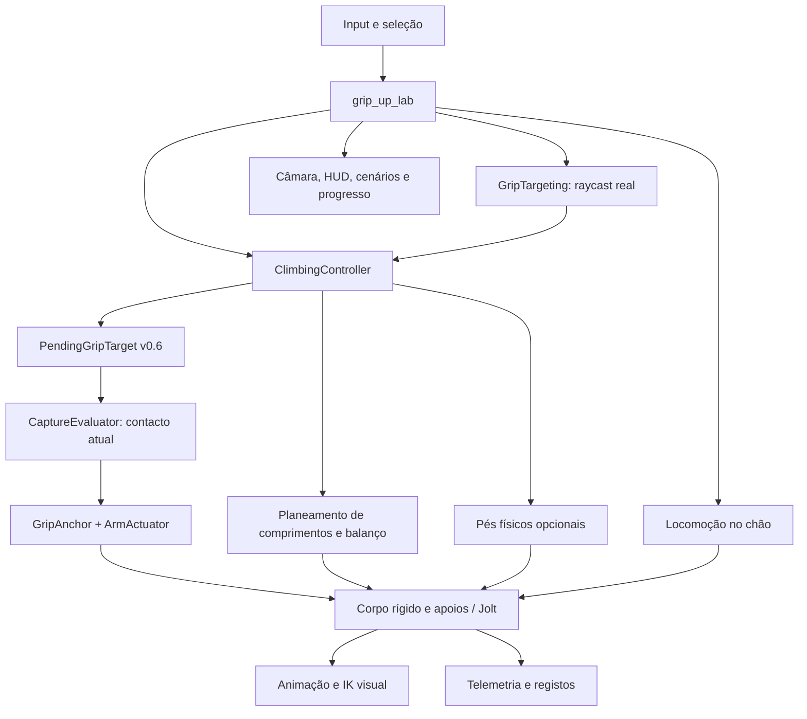

# GRIP UP — relatório completo do sistema implementado

Data: 19 de outubro de 2026. Estado de referência: v0.6, seleção antecipada de alvos fora de alcance. Projeto principal: `E:\Godot Games\grip_up`. Repositório: [wynterCG/grip_up](https://github.com/wynterCG/grip_up). Este relatório descreve o código e as evidências existentes; as especificações fornecidas estão em [docs/specs](../specs/).

## 1. O que existe neste momento

Existe um laboratório jogável para PC de escalada física com um bípede, movimento no chão, duas mãos independentes, contacto em superfícies livres, balanço apoiado, transferência de apoio, cenários estáticos e uma estrutura articulada. O corpo responde a forças e momentos limitados; as mãos prendem pontos materiais das superfícies e os apoios dinâmicos recebem reações. O modelo visual acompanha a simulação através de animação e IK.

A v0.6 acrescenta uma possibilidade concreta: manter premido o botão de uma mão sobre uma superfície visível ainda distante. A seleção permanece nesse ponto enquanto o jogador anda ou balança para o alcançar. Selecionar não agarra, não puxa o corpo e não cria apoio. Só o contacto real, dentro do alcance anatómico e sem obstáculos, cria a pega.

Há vários modos de controlo e experiências preservados para comparação. Nem todas as opções de investigação estão aprovadas como experiência principal. O arranque continua no perfil contextual 2; a seleção antecipada é uma opção do perfil independente 3 e começa desligada. Os atalhos v0.6 em Controls abrem diretamente os cenários com a experiência ligada.

O produto continua a ser um protótipo de mecânicas. Não existe ainda uma campanha, progressão, tutorial final, sistema completo de resistência, mantle/top-out ou uma apresentação pronta para publicação. Uma passagem automática demonstra viabilidade técnica, não conforto humano.

## 2. Base técnica e organização

| Elemento | Implementação atual |
|---|---|
| Motor | Godot 4.7.2, GDScript |
| Física | Jolt integrado no Godot |
| Frequência padrão | 120 Hz; caminhos centrais e regressões também a 60 Hz |
| Interpolação | Interpolação física ligada; apresentação acompanha transforms interpolados |
| Renderização | Compatibility / OpenGL; MSAA 2× |
| Plataforma de trabalho | Windows, rato e teclado |
| Cena de entrada | `features/grip_up/scenes/grip_up_lab.tscn` |
| Build atual | `builds/GripUp-v0.6.exe` |
| Automatização do editor | Godot MCP Pro, utilizado para execução, input, diagnósticos e capturas |

A cena principal coordena o laboratório; a física permanece em módulos próprios. O grafo abaixo mostra responsabilidades, não a totalidade das chamadas internas.



O controlador físico recebe intenção, seleciona os apoios autorizados e calcula a atuação. A câmara, o cursor e o esqueleto visual não impõem a posição do torso. O protótipo GRIP UP é separado de Janga; o `physics_grabber.gd` original permanece inalterado.

## 3. O corpo físico do personagem

O personagem usa **um RigidBody3D dinâmico**, de 12 kg, com formas de colisão compostas para tronco, região inferior, cabeça e sola. As pernas e os braços não são uma cadeia de corpos rígidos com massa individual. As mãos são extremidades virtuais de atuadores; o esqueleto renderizado representa o resultado.

Esta opção permite testar suspensão e transferência sem a instabilidade de um ragdoll completo. Tem uma consequência importante: dobrar um joelho visualmente não desloca a massa dessa perna nem altera a forma de colisão do corpo. A pose gráfica não constitui uma simulação biomecânica integral.

O corpo tem CCD ligado, não adormece, usa centro de massa personalizado na origem e recebe gravidade, colisões e fricção. A fricção do bípede é 0,12. O amortecimento próprio linear é 0,08 e o angular 0,35, em DAMP_MODE_COMBINE: acumulam com o amortecimento do mundo. A camada do corpo é 4, com máscara 3 para o mundo e os apoios. A orientação pode mudar sob forças externas; existe assistência limitada, não um bloqueio permanente de rotação.

## 4. Anatomia e parâmetros efetivos

Os valores seguintes são os usados pelo bípede atual. Os valores genéricos de outros recursos não devem ser confundidos com esta configuração.

| Parâmetro | Valor |
|---|---:|
| Massa do corpo | 12 kg |
| Ombros locais | `(±0,1919; 0,5241; 0,0153)` m |
| Comprimento medido do braço no rig | aproximadamente 0,54708 m |
| Extensão da palma usada pelo sistema | 0,11 m |
| Alcance anatómico de contacto, ombro → palma | aproximadamente 0,65708 m; a v0.6 permite selecionar mais longe |
| Intervalo de comprimento de repouso do atuador | 0,18–0,62 m |
| Margem elástica existente | 0,04 m |
| Velocidade máxima do gesto de alcance | 4 m/s; na v0.6, relativamente ao referencial físico do ombro; no alcance legado/livre, limite mundial |
| Rigidez axial K | 6000 N/m |
| Amortecimento axial D | 220 N·s/m |
| Erro máximo usado na mola | 0,12 m |
| Força total das mãos | 360 N partilhados |
| Momento de assistência | 20 N·m partilhados |
| Momento resultante de escalada | máximo de 150 N·m |
| Aquisição progressiva da pega | 0,10 s |
| Resposta da distribuição entre mãos | 0,14 s |
| Resposta da intenção | 0,12 s |

O alcance anatómico e o comprimento de repouso são grandezas diferentes. Uma mão pode contactar perto de 0,65708 m; o alvo de repouso continua limitado a 0,62 m. Nesse extremo há cerca de 0,03708 m de pré-carga real, introduzida através do blend e dos limites existentes. Não foi aumentado o intervalo para esconder esta diferença.

## 5. Mãos, pegas e forças

Cada mão mantém estado, ponto de apoio, normal, comprimento real, comprimento pedido, força, distribuição, razão de transição e dados de contacto. Os estados incluem FREE, REACHING, ATTACHED, SLIPPING e RELEASED. A v0.6 mantém REACHING para compatibilidade e acrescenta subestados de espera/alcance nos diagnósticos.

Uma pega guarda o ponto e a normal **no espaço local do suporte**. Se uma viga roda, o ponto acompanha esse material; não permanece preso numa coordenada mundial antiga. A referência ao objeto permite detetar remoção e invalidação.

O atuador axial produz tração. Uma forma resumida da integração implícita usada é:

```text
T = max(0, (K × max(erro, 0) − D × velocidade_axial_relativa)
             / (1 + (D × dt + K × dt²) × massa_inversa_efetiva))
```

O erro é limitado, e um braço suficientemente comprimido não empurra a parede como uma barra rígida. A massa efetiva inclui o efeito rotacional do ponto de aplicação. A reação no apoio dinâmico é aplicada no contacto correspondente.

Duas mãos dividem o mesmo orçamento de 360 N. Acrescentar uma mão melhora a geometria de controlo e a distribuição, sem duplicar a força disponível. A assistência angular também partilha 20 N·m; o momento resultante mantém o teto de 150 N·m. A nova mão entra progressivamente, sem escrever a posição, orientação ou velocidades do corpo.

Existe um momento limitado na pega, incluindo controlo de torção com rigidez 16 N·m/rad e amortecimento 3 N·m·s/rad, e amortecimento angular de atitude 2. Por isso, a pega não é uma junta esférica ideal sem momento. Também não é uma orientação congelada: uma solicitação superior à capacidade altera a pose.

## 6. Sobrecarga, deslizamento e perda de apoio

O limite de carga da mão usa `grip_load_limit` do suporte quando existe; o fallback é 260 N. As superfícies principais dos cenários têm 460 N. Este valor é um limiar de integridade, não uma força instantânea extra: o teto partilhado de 360 N continua a aplicar-se.

Sobrecarga persistente durante 0,20 s leva a SLIPPING. Nesse estado a força é multiplicada por 0,65; 0,40 s de deslizamento termina a pega. Há recuperação se a carga permanecer abaixo de 75% do limite durante 0,16 s. Fora de sobrecarga, o temporizador de confirmação decai.

Nas mãos, SLIPPING representa perda de capacidade e posterior libertação; não existe uma simulação completa de dedos a deslizar continuamente pela superfície. O ponto material permanece o da pega. A integridade dos pés tem uma implementação diferente, com contacto de deslizamento próprio.

O controlador também pode libertar por extensão excessiva, apoio inválido, reset ou input. Uma pega geometricamente válida pode falhar sob a carga seguinte; contacto, retenção e sucesso no percurso são eventos distintos.

## 7. Seleção de superfícies e liberdade de escalada

`grip_targeting.gd` lança raios reais da câmara, até 70 m, com máscara 3 e exclusão do próprio corpo. Usa o ponto central e pequenas amostras em redor do cursor: deslocamentos de 12 píxeis nos eixos e duas diagonais de 8 píxeis. Um obstáculo sólido interposto ganha o teste de visibilidade; não se seleciona através dele.

Os apoios pintados e numerados orientam percursos e testes. Não são os únicos sockets autorizados: as superfícies marcadas como agarráveis aceitam pontos livres. Essa liberdade não equivale a agarrar qualquer objeto ou qualquer ponto invisível; continua sujeita à elegibilidade, visibilidade, alcance físico e contacto.

Na aquisição antiga, o pedido podia ser recusado logo por estar fora do alcance. Na nova experiência v0.6, o raycast ainda tem de acertar numa superfície elegível, mas a distância anatómica deixa de impedir a seleção inicial.

## 8. v0.6: seleção antecipada fora de alcance

### 8.1 Contrato para o jogador

1. Apontar para uma superfície visível e manter LMB ou RMB.
2. A mão correspondente memoriza o ponto exato. Se estiver longe, mostra TARGET PENDING / OUT OF REACH.
3. Andar ou balançar para o alcançar. Mover o cursor ou orbitar não escolhe outro ponto.
4. A mão aproxima-se com velocidade finita, respeita obstáculos e só prende no contacto real.
5. Soltar o botão cancela a espera ou liberta a pega dessa mão.

Não existe um novo modificador, nem é necessário um segundo clique quando o alvo entra em alcance. Enquanto o botão permanece premido e o suporte é válido, a seleção não expira pelos antigos 120 ms ou 0,65 s.

### 8.2 Dados e invariantes

`PendingGripTarget` guarda mão, held, objeto, ponto e normal locais, instante de seleção, identificador da seleção e tentativa, estado de alcance, endpoint, bloqueio e histórico compacto de transições. Os identificadores de seleção e de tentativa são separados; uma tentativa desconhecida usa −1.

Cada passo físico recalcula o ombro real e o ponto material atual. Uma mão pendente tem **força zero, reação zero e distribuição zero**. Não conta como apoio para os pés nem desliga o movimento no chão por si só. A mão já agarrada conserva o seu apoio e alvo de comprimento até existir uma segunda pega real.

Os rótulos usam histerese de 3 mm para evitar oscilações visuais. A autorização física usa o limiar efetivo de alcance, com pequena tolerância numérica, sem herdar essa histerese. TARGET_LEFT_REACH_PENDING é uma transição reversível; não equivale à falha definitiva antiga TARGET_LEFT_REACH.

### 8.3 Movimento da mão e obstáculos

A mão é transportada pelos sucessivos referenciais físicos do ombro e executa um gesto adicional limitado a 4 m/s. O sistema mede separadamente velocidade de transporte, do gesto e mundial. Assim, 4 m/s não é anunciado como teto universal da velocidade mundial de uma mão cujo corpo se desloca.

O segmento mundial completo é verificado contra obstáculos. O endpoint tem de pertencer simultaneamente ao espaço anatómico e ao passo de gesto permitido. Um bloqueio temporário mantém a seleção e impede o contacto; quando o caminho fica livre, a tentativa pode continuar.

Existe um caso degenerado explícito: se a interseção entre o movimento permitido e o espaço anatómico estiver vazia depois de uma deslocação/rotação do ombro, a tentativa termina com WORKSPACE_SWEEP_CONFLICT. O endpoint histórico fica marcado como inválido e sem atuação. A recuperação livre é finita; a apresentação usa um fallback passivo do rig enquanto esse ponto não é válido. Isto é uma limitação observável, não uma chegada física bem-sucedida nem uma mão válida fora do alcance.

### 8.4 Autoridade para agarrar

O controlador exige botão ainda premido, suporte válido, caminho livre, endpoint válido, alcance físico atual e chegada ao ponto selecionado. A diferença entre endpoint e alvo tem de ser praticamente nula, com teste explícito de 1e−6 m, antes de chamar sempre o CaptureEvaluator existente.

O avaliador confirma a geometria atual: tolerância de endpoint de 1 mm, proximidade de superfície de 3 mm, sonda normal de ±12 mm, compatibilidade da normal e visibilidade. Previsões, rótulos e estimativas de carga não autorizam o contacto. Um ponto próximo da mão, mas atrás de uma parede, continua sem ser um apoio.

Na aceitação, o ponto material selecionado torna-se a âncora, o comprimento real fica registado e o alvo inicial passa pelo limite antigo de 0,18–0,62 m. A força entra pelo blend normal. A carga de aquisição igual a zero refere-se ao instante anterior ao blend; a primeira força aplicada e o pico subsequente são campos separados.

### 8.5 Cancelamento e integração

Mouse-up funciona também sobre UI. Abrir controlos, perder foco, mudar de perfil, desligar a experiência, resetar, remover ou invalidar o apoio cancela as seleções correspondentes. Voltar a assinalar held não ressuscita uma tentativa cancelada sem nova seleção.

Mãos agarradas antes de ligar a opção continuam a libertar corretamente. A opção está limitada ao perfil 3. Se estiver ativa, a seleção persistente tem prioridade sobre os buffers antigos; desligada, a aquisição anterior permanece recuperável e coberta por testes de equivalência.

### 8.6 Informação visual

O alvo distante elegível tem indicação âmbar; o alcançável mantém indicação verde. Pequenos anéis mostram os pontos pendentes e seguem o transform interpolado do suporte a partir do ponto local exato. Não têm colisão nem deslocam o alvo para o cursor atual.

O HUD distingue pendente, caminho bloqueado, a alcançar e agarrado. O diagnóstico mostra distância ao alvo, margem de alcance, tempo em espera, velocidades do gesto/transporte/mundo e bloqueador. O comprimento atual da mão e a distância ao alvo remoto são apresentados separadamente.

## 9. Perfis de input preservados

| Perfil | Rato | W/S e A/D | Utilidade atual |
|---|---|---|---|
| 0 — legado | Seleção original | W/S comandam puxar/baixar; A/D viés lateral | Comparação histórica, incluindo lançamento original |
| 1 — v0.3 drag | Cursor visível; delta vertical contrai/estende quando apoiado | Balanço em profundidade e lateral | Comparação de arrasto e hold-to-grip |
| 2 — contextual | Movimento relativo capturado dirige mãos livres e esforço apoiado | Balanço quando agarrado; andar no chão | Perfil de arranque preservado |
| 3 — independent aim | Cursor visível seleciona contactos; não comanda comprimento | Balanço apoiado; andar no chão | Base v0.4/v0.5 e experiência v0.6 |

No perfil 1, subir o rato contrai e descer estende; a sensibilidade é 0,0015 m/píxel, com zona morta e taxa máxima de 0,6 m/s. Excesso de deslocamento não fica numa fila invisível.

No perfil 2, a inversão pedida está preservada: **rato para baixo pede puxar; rato para cima pede extensão/descida apoiada**, ao mesmo tempo que dirige a mão livre. A sensibilidade do alvo virtual é 0,0018; os alvos usam um plano relativo à câmara, profundidade e alcance anatómico. Este modo ainda partilha intenção de mira e esforço; não é a solução de mira independente.

No perfil 3, procurar uma pega mais alta não volta a estender o braço de apoio por causa da posição absoluta do cursor. Os comprimentos vêm da política de postura, não da coordenada vertical do rato. A v0.6 acrescenta a espera persistente nesse perfil.

## 10. Mapeamento, foco e câmara durante o input

LMB controla a mão esquerda e RMB a direita em hold-to-grip. MMB orbita; roda aproxima/afasta; R repete; Tab mostra diagnósticos; Esc abre controlos; F permite a comparação fixa/articulada no cenário aplicável. Space conserva o sistema de lançamento, com opt-in nos perfis mais recentes.

`ClimbingInputRouter` traduz teclas para ações, deteta conflitos e guarda remapeamentos em `user://controls.cfg`. MMB e roda estão reservados à câmara. Não existe ainda uma configuração completa equivalente para touch ou gamepad.

WASD conserva a direção mundial capturada ao premir cada tecla. Rodar o corpo ou orbitar a câmara enquanto a tecla continua premida não muda subitamente o eixo desse comando. Ao libertar e premir novamente, é usada a nova referência de câmara. Esta regra trata diretamente o problema de A/D trocar de eixo quando o personagem roda.

Perda de foco liberta pegas e limpa gestos antigos. O primeiro clique de regresso pode ser consumido para retomar o controlo. Abrir UI, orbitar e cruzar limites de modo limpam deltas antigos, evitando contração acumulada ao regressar ao jogo.

## 11. Locomoção third-person no chão

O mesmo corpo rígido é usado no chão e na suspensão. `GroundLocomotion` usa contacto sob a sola, normal suficientemente ascendente e tolerâncias de altura/orientação. Não troca para um CharacterBody nem escreve velocidade para obter o movimento desejado.

| Ajuste | Valor |
|---|---:|
| Velocidade desejada | 2,6 m/s |
| Aceleração | 14 m/s² |
| Travagem | 18 m/s² |
| Resposta horizontal | 14 |
| Rigidez de assistência vertical do corpo | 160 |
| Amortecimento angular de apoio | 18 |
| Velocidade alvo máxima de yaw | 7 rad/s; não é um hard cap da rotação física real |
| Momento total do motor no chão | 65 N·m |

A direção é relativa à câmara. Há assistência finita para manter o corpo de pé e virá-lo, além de resposta ao movimento do chão. Um apoio dinâmico recebe reação. Não existe força de andar no ar.

Pegas efetivas retiram autoridade ao motor no chão. Uma seleção distante v0.6 ainda pendente não o faz: é possível andar até ao alvo enquanto se mantém o botão. Isto não atribui sustentação à mão pendente.

## 12. Balanço, pêndulo e impulso

O balanço exige apoios reais. O cálculo do momento usa o braço entre o centro de massa e o ombro ponderado dos braços apoiados. A intenção filtrada produz um momento de reação limitado; o suporte recebe o momento oposto. Sem apoio válido, não há propulsão de escalada no ar.

O módulo usa resposta de intenção de 0,10 s, momento nominal de 18 N·m dentro do orçamento comum de 20 N·m e governador de velocidade relativa de 1,8 rad/s no eixo solicitado. Esse governador não é um hard cap da velocidade angular mundial inteira. Comando alinhado pode acrescentar energia; comando contrário pode travar. Não existe uma aceleração central ilimitada para levar o personagem ao destino.

Os diagnósticos separam movimento pendular, torção do tronco e roll. A estimativa de potência incremental usa o momento efetivamente admitido e a velocidade angular relativa. Valores acima/abaixo de ±0,01 W classificam bombeamento/travagem. O trabalho acumulado é uma medida do atuador observado, não um balanço energético exato de todo o mundo.

Os percursos de swing permitem selecionar uma superfície inicialmente fora do alcance e ganhar uma janela real através de input apoiado. Uma janela demasiado curta pode passar sem contacto; selecionar cedo não elimina a necessidade de movimento e timing.

## 13. Planeamento de comprimentos: A, B e C

Estas políticas de comprimento são diferentes das variantes de atitude P0/P1/P2.

| Política | Comportamento |
|---|---|
| A — hold length | Conserva o comprimento adquirido |
| B — bounded auto-pull | Calcula comprimentos absolutos para uma postura geométrica confortável |
| C — load-aware pull | Ajusta distribuição/geometria com informação de capacidade e direção do apoio |

Em B, a referência confortável é cerca de 0,312 m e a distância de postura à parede é 0,24 m. C limita pesos de distribuição a 20–80%. Os objetivos são derivados da configuração material dos apoios; uma cache com quantização local de 4 mm evita obter altura nova por repetir o mesmo ciclo de largar/agarrar nos mesmos pontos.

`ArmTargetCoordinator` limita a velocidade dos alvos a 0,25 m/s e a aceleração a 1 m/s². Usa tolerância de seguimento de 0,07 m, deteção de paragem de 0,25 s, prazo de 2 s e condições de saturação. Bloqueio, slip e perda de apoios provocam travagem/aborto. A indicação COMPLETE significa que os alvos dos braços foram atingidos; não certifica que todo o corpo chegou a uma pose ideal.

O planeador não teletransporta o corpo e não é ainda um resolvedor geral de postura com articulações, pernas, equilíbrio e obstáculos de corpo inteiro.

## 14. Atitude: P0, P1 e P2

**P0** preserva a suspensão da v0.4. A assistência nova começa desligada.

**P1** acrescenta referência de torção axial relativa ao material do apoio, com transporte limitado a 2,5 rad/s, resposta de 0,10 s e blend de 0,20 s. No ensaio de apoio rotativo reduziu a torção medida em cerca de 90%, mantendo equivalência no caso de parede fixa. É uma melhoria localizada e opcional, sem aumentar o orçamento de momento.

**P2** experimenta alinhamento suave com a gravidade em função do apoio, com taxa de referência de 0,8 rad/s, aceleração de 3 rad/s² e blend de 0,25 s. Faz crossfade com a assistência anterior em vez de somar dois controladores. O corpo pode ficar mais vertical, mas os testes mostraram alteração da dissipação/trabalho e janelas de contacto mais curtas. Por isso foi **rejeitado como novo comportamento por defeito**. Continua disponível para investigação.

Uma pose visual mais direita não é, por si só, prova de melhor controlo ou escalada mais física.

## 15. Lançamento com Space

Existe um sistema de carga e tração com estados IDLE, CHARGING, PULLING e COOLDOWN. Os tempos principais são 0,45 s de carga, 0,30 s de tração e 0,45 s de cooldown; a contração de lançamento do bípede usa 2 m/s.

O lançamento usa as pegas reais e o orçamento dos braços. Não escreve uma velocidade ascendente no corpo. A propriedade das âncoras é verificada para um lançamento antigo não atuar numa pega nova. Pés físicos são desligados temporariamente durante as fases relevantes; não há impulso de pernas escondido.

O mecanismo original permanece no perfil legado. Nos perfis mais recentes começa desligado e requer a opção experimental explícita. Não se deve confundir este lançamento com o bombeamento contínuo por WASD.

## 16. Bípede visual, animação e IK

O modelo é o mannequin do **Quaternius Universal Animation Library**, com licença CC0 e proveniência incluídas em [assets/characters/quaternius_mannequin](../../features/grip_up/assets/characters/quaternius_mannequin/). O GLB preservado tem SHA-256 `69591853d817488edaa8fd9bf8fc1d821eaeaf789f8627b3cd23b41c4ed67997`. Os metadados indicam 65 juntas, 43 clips e 13 744 triângulos; isso não significa que os 43 clips participem na jogabilidade.

No chão são usados Idle e Walk, com transição de 0,16 s. Fora do chão há uma pose base A_TPose e TwoBoneIK3D nos quatro membros. O IK não alonga os ossos para alcançar arbitrariamente. A palma usa o offset de 0,11 m; um modificador posterior ajusta orientação de mão/dedos. O perfil contextual pode aplicar IK dos braços sobre o andar para permitir apontar no chão.

O esqueleto segue o corpo e os apoios interpolados. Há suavização dos alvos/polos e das misturas, mas nenhum root motion a conduzir a física. Quando uma pose extrema não cabe no rig, a limitação visual não deve ser interpretada como capacidade física adicional.

Existe uma cena de preview do bípede para inspecionar os clips separadamente do laboratório.

## 17. Pernas visuais: livres, acopladas e apoiadas

`BipedLegMotion` trata as pernas como movimento passivo visual com gravidade, amortecimento e acoplamento suave entre as duas. Usa K de acoplamento 6, D 2,2, gravidade 9,8 m/s², referência de repouso fraca de 1,2, amortecimento 0,85, subpassos até 120 Hz e limite angular de 6 rad/s. A aceleração da anca é filtrada e limitada a 35 m/s² para este cálculo.

Quando totalmente suspenso, o personagem não fica agachado por uma pose fixa: as pernas aproximam-se da extensão medida, cerca de 0,82979 m cada, e acompanham o movimento do corpo. O acoplamento faz uma seguir a outra sem eliminar liberdade individual.

Quando encontra superfícies, as pernas podem fletir e os testes visuais de sola/dedos limitam penetrações. Esta camada melhora a leitura e a fluidez, mas não suporta peso. A sustentação adicional só existe com o módulo físico opcional seguinte.

## 18. Pés físicos opcionais

Esta experiência começa desligada. `FootholdCandidateSampler` procura candidatos através de geometria, comprimento da perna, região da anca, visibilidade e aproximação; a procura ocorre aproximadamente a cada 100 ms. `FootContactSolver` produz reação após contacto real.

Os estados são FREE, SEARCHING, PLANTING, SUPPORTING e SLIDING. O pé eleva, passa sobre o obstáculo e planta com movimento finito e testes de caminho; não ganha força por antecipação. O ponto e a normal são guardados no material do suporte.

| Parâmetro | Valor |
|---|---:|
| Força total das pernas | 180 N |
| Limite por pé | 120 N |
| Rigidez | 1800 N/m |
| Amortecimento | 100 N·s/m |
| Pré-carga | 0,025 m |
| Entrada em apoio | 0,12 s |
| Velocidade de plantação | 2 m/s |
| Extensão/descida | 0,30 / 0,40 m/s |
| Coeficiente de fricção pretendido | 0,85, condicionado pelo material |

A força é unilateral: normal positiva e tangencial dentro do cone de fricção. Não há pé a puxar a parede nem sucção. O orçamento das pernas é separado dos 360 N das mãos; o momento combinado continua sujeito ao limite existente de 150 N·m.

Um pé já apoiado pode permanecer depois de largar as mãos, mas não se procuram novos apoios de escalada sem as condições apropriadas. Uma mão apenas pendente não ativa esse apoio. Não há ainda controlo manual completo de cada pé ou planeamento de rota do corpo inteiro.

## 19. Previsão, avaliação de alcance e buffers antigos

O projeto conserva módulos anteriores à seleção persistente:

| Sistema | Função | O que não autoriza |
|---|---|---|
| GripCapturePredictor | Amostra um horizonte curto com trajetória finita da mão e movimento previsto | Não cria contacto futuro |
| GripCaptureEvaluator | Avalia a geometria atual e estima risco de retenção | A estimativa de carga não garante sobrevivência da pega |
| ReachAssessment | Explica distância, janela, confiança e risco | Não permite agarrar fora da anatomia |
| GripIntentBuffer | Conserva brevemente uma intenção held, normalmente 120 ms | Não é espera persistente nem retarget automático |
| PendingGripTarget v0.6 | Conserva o mesmo material enquanto o botão permanece premido | Não acrescenta alcance ou força |

O preditor usa horizonte habitual de 0,20 s, limitado a 0,10–0,25 s, com amostras de 1/120 s. Aproxima o movimento futuro do corpo e do suporte; juntas/contactos externos podem tornar a previsão incerta. O aconselhamento é deliberadamente separado da autoridade de contacto.

Os buffers curtos configuráveis de 100–150 ms e as previsões continuam opt-in. Não foram silenciosamente transformados no sistema v0.6. Cada nova tentativa limpa os tempos, motivos de falha e previsões antigos para não herdar resultados de outra pega.

## 20. Câmara, janela e apresentação

`ClimbingCamera` segue o corpo com foco acima do tronco e pequena antecipação de velocidade. O raio base é 6 m; o dolly admite 3–17 m. Orbit usa limites de yaw/elevacão, e há resposta suavizada para foco e posição. O foco inclui aproximadamente 0,6 m acima do corpo e antecipação de 0,12 s da velocidade limitada.

A oclusão usa um raio entre foco e posição desejada, excluindo o próprio corpo, e um afastamento de 0,25 m da superfície encontrada. Não é ainda uma solução volumétrica completa que garanta todos os cantos do near plane em corredores estreitos.

A janela tem referência de 1920×1080, tamanho inicial 1440×810, mínimo de runtime 1024×576, `resizable=true`, stretch `canvas_items` e aspeto `expand`. O HUD usa anchors e o painel de controlos tem scroll. O viewport acompanha a área disponível segundo essa configuração.

Os testes v0.6 verificam que o aviso de resize e mudanças de câmara não retargetam a seleção. A sessão nativa decorreu no viewport embebido do editor; uma tentativa de alterar o tamanho da janela por código não constitui prova de arrastar fisicamente a janela de desktop. Esse limite da evidência fica explícito.

## 21. Cenários, objetivos e progresso

| Cenário | Conteúdo implementado | Finalidade |
|---|---|---|
| 01 Static Climb | Parede agarrável, pequenas saliências, guias numeradas, checkpoint e altura de objetivo | Aprender alcance, suspensão e alternância |
| 02 Swing & Catch | Apoio inicial e destino separado | Balanço e aquisição de uma nova superfície |
| 03 Reactive Structure | Viga de 15 kg com HingeJoint3D e comparação fixa/articulada | Reações, ponto material, torção e handoff |
| 04 Foot Support | Geometria com locais reais para os pés | Comparar pernas visuais e pés físicos |
| 05 Ten Transfer Lab | Parede de referência com 11 guias alternadas | Medir dez transferências contínuas |
| 06 Swing-required route | Destino inferior distante, inicialmente fora do alcance estático | Ganhar janela de contacto por balanço |

No cenário 03, a viga tem pivô em `(-0,8; 2,05; 0)`, limites angulares de aproximadamente −0,6 a +0,2 rad e centro de massa personalizado com lastro. É uma estrutura realmente reativa; não equivale à implementação de um sistema genérico de desafios reativos.

No cenário 05, o espaçamento é ajustável entre 0,08 e 0,16 m, com referência de 0,12 m e assimetria lateral. As guias são pintura, não exclusividade de contacto. O contador exige contacto efetivo da mão seguinte e libertação da anterior; interrupções são registadas como recuperações. Os atalhos v0.6 reutilizam a geometria existente.

Há chão de segurança e reset rápido. Não existe ainda uma sequência final de níveis com desbloqueios, classificação de campanha ou persistência de progresso.

## 22. UI, áudio e ferramentas de diagnóstico

O HUD mostra estado de cada mão, comprimento atual/alvo/plano e força. Controls reúne seleção de cenários de estudo, perfis, políticas, variantes, flags, remapeamentos e classificações opcionais. A distinção entre comprimento real, pedido e planeado evita interpretar intenção como movimento físico já executado.

Tab acrescenta ombros, alcance anatómico, caminhos, âncoras, forças, razões de falha, estado do coordenador, pêndulo/torção/roll, potência e trabalho estimados. As esferas de alcance são desenhadas como grandes círculos de referência; não são volumes de colisão adicionais.

O áudio é de protótipo: dois AudioStreamPlayers reproduzem sinais gerados de contacto e libertação, aproximadamente 620 Hz/45 ms e 340 Hz/25 ms, a 22,05 kHz/16 bits e −23 dB. Existe mute. A seleção pendente não toca o som de agarrar. Não há ainda música, narração, sistema de mistura adaptativa ou biblioteca final de sons espaciais.

## 23. Telemetria, ficheiros e reprodutibilidade

`CaptureTrace` pode guardar JSONL a intervalos de 50 ms: transform e velocidades do corpo, mãos, pés, forças, input, câmara, planeamento, flags e diagnósticos pendentes. Começa desligado para uso normal.

`TransferDiagnostics` mantém até 256 eventos copiados e um último resultado compacto por mão. Os registos distinguem seleção, entrada/saída de alcance, bloqueio, contacto, slip, cancelamento e conclusão. Os snapshots da aquisição não são alterados retroativamente para representar outra tentativa.

| Local | Conteúdo |
|---|---|
| `user://controls.cfg` | Remapeamentos |
| `user://transfer_sessions/<id>.jsonl` | Eventos por sessão |
| `user://transfer_sessions/<id>_summary.jsonl` | Resumos e avaliações do perfil de estudo |
| `user://v06_final_native_<hz>hz.jsonl` | Trace das sessões nativas automatizadas desta fase |
| `docs/validation/v06/` | Resultados e logs integrais das regressões |
| `docs/validation/v06_final/` | Evidências finais, exportação e verificação |

O identificador de sessão combina instante UTC, processo e contador, evitando escrever todas as sessões concorrentes no mesmo ficheiro. Estes dados não são um sistema de save do jogo nem analytics online. Os testes registam explicitamente a sua origem automatizada.

## 24. Validação e significado dos resultados

A matriz completa da v0.6 passou **3116 verificações**, com testes às frequências suportadas de 120 e 60 Hz; o teste estático do asset corre uma vez. O agregado e cada footer podem ser consultados em [v06/results.json](../validation/v06/results.json). Asserções cobrem invariantes e percursos concretos, não todos os estados possíveis de uma simulação contínua.

| Área nova | Verificações por frequência |
|---|---:|
| Baseline distante com opção desligada | 4 |
| Seleção, cancelamento e equivalência OFF | 32 |
| Movimento finito, material móvel e obstrução | 32 |
| Contacto, handoff, velocidade, sobrecarga e reações | 47 |
| Input e integração no laboratório | 27 |
| Percursos com seleção antecipada | 16 |
| Swing com seleção antecipada, P0/P1/P2 | 30 |

Os percursos automáticos de 0,12 e 0,14 m completam dez transferências. A 120 Hz, incluem respetivamente 8 e 9 seleções inicialmente fora de alcance, todas convertidas em contacto; os tempos medidos foram cerca de 20,04 e 20,65 s. Os máximos de força desses ensaios foram aproximadamente 176,26 e 173,58 N, dentro dos mesmos limites. Não são tempos humanos ou resultados de uma competição.

Os ensaios M3 distinguem uma chegada moderada com contacto, uma passagem demasiado rápida sem contacto e uma pega fraca que contacta e só depois perde capacidade. A avaliação não transforma uma falha de retenção numa falha de mira. O relatório físico detalha conservação e limites em [FISICA_IMPLEMENTADA_V06_PT.md](FISICA_IMPLEMENTADA_V06_PT.md) e [V06_M3_PHYSICS.md](../validation/V06_M3_PHYSICS.md).

As sessões nativas via Godot MCP Pro acrescentam imagem, input e observação de execução ao conjunto headless. Continuam a ser guiões automáticos. Os resultados finais e o estado da exportação ficam em [V06.md](../validation/V06.md), para não confundir uma contagem intermédia com a evidência final.

Uma primeira sessão nativa expôs um problema no desenho do ensaio: B aproximava o corpo durante a suposta espera estática; o alvo entrava legitimamente em alcance e agarrava. A tentativa de swing seguinte reutilizava essa pose e perdeu a pega por extensão. A evidência inicial foi preservada. O ensaio foi dividido num alvo realmente distante e num cenário de swing fresco; não se aumentaram forças, alcance ou retenção para obter uma passagem.

## 25. O que foi observado por uma pessoa e o que falta validar

Existe uma sessão interativa anterior, da v0.5/P0, com dez transferências e zero recuperações, observada nos registos em aproximadamente 39,51 s. Não há avaliações comparativas confirmadas de conforto, fadiga ou agência. Outra sessão sem completar o contador pode ter sido exploração livre e não é automaticamente classificada como falha.

A v0.6 ainda necessita da comparação humana do mesmo percurso com a opção desligada e ligada, incluindo repetições e os cenários de swing/viga. O protocolo está em [V06_PILOT.md](../playtests/V06_PILOT.md). Os critérios incluem compreensão do alvo pendente, controlo da mão livre, cancelamento, fadiga, sensação de contacto e retenção após handoff.

Assim, a recomendação técnica é manter a seleção antecipada disponível como **opt-in**, preservar o baseline e obter essa comparação antes de a promover a comportamento inicial. Aprovação técnica e aceitação de game feel são decisões distintas.

## 26. Limitações conhecidas e decisões conscientes

| Limitação | Implicação prática |
|---|---|
| Corpo único com membros visuais | Sem transferência de massa individual de braços/pernas nem ragdoll completo |
| Anatomia aproximada por alcance e IK | Não há limites articulares humanos completos nem colisão de cada dedo/membro |
| Caminhos por segmentos/raycast | Não equivalem ao volume completo de uma mão e antebraço |
| Força e momento finitos | Contacto pode ser seguido por slip, extensão excessiva ou queda |
| Workspace sweep degenerado | A tentativa pode cancelar explicitamente; não é corrigida com teleporte |
| Previsões curtas aproximadas | Juntas e contactos futuros podem invalidar o prognóstico |
| Centro de massa AUTO no atuador legado | A aproximação de velocidade/massa efetiva continua fora da correção local v0.6 |
| P2 altera dinâmica de forma indesejada | Mantido para investigação, rejeitado como novo padrão |
| Colisor não acompanha cada joelho visual | Algumas saliências ainda podem interferir com o volume rígido do corpo |
| Câmara por raio | Casos estreitos de oclusão podem exigir solução volumétrica |
| Sem esquema touch/gamepad completo | A build atual é uma experiência PC |
| Sem piloto humano v0.6 concluído | Não está demonstrado que a mudança melhora conforto/flow |

A correção local de centro de massa merece detalhe: a velocidade do ponto de uma âncora criada pela nova seleção usa o centro de massa real do estado físico, incluindo rotação do suporte. No ensaio assimétrico, o erro antigo de cerca de 0,32311 m/s passou a inferior a 1e−6 m/s. A opção é isolada nas novas âncoras; o ArmActuator legado continua com a sua aproximação para corpos AUTO assimétricos. Não se reivindica exatidão geral de todas as estimativas de captura.

No teste de transferência de momento com inércia anisotrópica mediu-se deriva residual não nula. Foi comparada com o solver desativado e documentada; não se substituiu o resultado por um zero artificial. O relatório físico contém os números e o controlo isotrópico.

## 27. Reservado ou ainda não implementado

As flags `posture_solver`, `directional_grip_quality` e `reactive_challenge` aparecem como opções reservadas/telemetria, sem o algoritmo correspondente a consumi-las. Não são funcionalidades completas. O planeamento geométrico atual de comprimentos não deve ser apresentado como o futuro solver de corpo inteiro.

Também não existem ainda: mantle/top-out dedicado, escalada biomecânica completa, stamina/lesões, dedos físicos, ragdoll articulado integral, planeamento autónomo de rotas, controlo manual completo dos pés, campanha final, progressão persistente, multiplayer, IA de adversários, esquema mobile final, exportação Android desta fase, arte/áudio final ou integração de lojas.

O próximo trabalho de jogabilidade deve ser escolhido a partir da experiência humana dos sistemas existentes. O relatório não declara estas reservas como bugs corrigidos ou como trabalho já entregue.

## 28. Mapa dos ficheiros principais

Todos os caminhos abaixo partem da raiz do projeto. Nos scripts e recursos, os nomes correspondem às responsabilidades atuais.

| Ficheiro/módulo | Responsabilidade |
|---|---|
| `features/grip_up/scripts/grip_up_lab.gd` | Cena principal, input de alto nível, UI, cenários, integração e sessões |
| `scripts/climbing_controller.gd` | Estados, apoios, atuação, limites, lançamento e telemetria física |
| `scripts/pending_grip_target.gd` | Seleção persistente, movimento finito e estado de alcance v0.6 |
| `scripts/grip_targeting.gd` | Seleção real a partir da câmara |
| `scripts/grip_anchor.gd` | Ponto/normal materiais, validade e velocidade do apoio |
| `scripts/arm_actuator.gd` | Mola axial implícita e massa efetiva |
| `scripts/climbing_input_router.gd` | Ações, remapeamento, conflitos e propriedade dos gestos |
| `scripts/contextual_arm_input.gd` | Alvos relativos e esforço contextual |
| `scripts/support_posture_planner.gd` | Objetivos absolutos A/B/C por configuração de apoios |
| `scripts/arm_target_coordinator.gd` | Taxas, acelerações, travagem e abortos dos objetivos |
| `scripts/supported_swing.gd` | Balanço, governador e reação nos apoios |
| `scripts/supported_twist_refinement.gd` | Variante P1 |
| `scripts/supported_posture_refinement.gd` | Variante P2 |
| `scripts/ground_locomotion.gd` | Locomoção e orientação físicas no chão |
| `scripts/foot_contact_solver.gd` | Contacto e reação dos pés opcionais |
| `scripts/foothold_candidate_sampler.gd` | Procura local de apoios para pés |
| `scripts/biped_visual.gd` | Modelo, animação, IK e apresentação interpolada |
| `scripts/biped_hand_pose.gd` | Orientação visual de mãos |
| `scripts/biped_leg_motion.gd` | Movimento passivo visual das pernas |
| `scripts/climbing_camera.gd` | Follow, orbit, dolly e oclusão |
| `scripts/grip_capture_predictor.gd` | Previsão curta, sem autoridade de contacto |
| `scripts/grip_capture_evaluator.gd` | Geometria real de contacto e estimativa de risco |
| `scripts/reach_assessment.gd` | Explicação de alcance e confiança |
| `scripts/grip_intent_buffer.gd` | Buffer curto antigo |
| `scripts/capture_trace.gd` | Trace JSONL opcional |
| `scripts/transfer_diagnostics.gd` | Eventos e snapshots de tentativa |
| `scripts/transfer_route_progress.gd` | Progresso das dez transferências |
| `scripts/grip_feedback.gd` | Sons de contacto/libertação |
| `scripts/climb_test_level.gd` | Cenários originais |
| `scripts/transfer_test_level.gd` | Percursos de referência e swing separado |
| `resources/climbing_tuning.gd`, `biped_tuning.gd`, `foot_tuning.gd` | Parâmetros exportados |
| `features/grip_up/tests/` | Ensaios headless e guiões nativos de captura |
| `tools/project.py` | Sync, testes, MCP, exportação e smoke |
| `tools/run_regressions.py` | Matriz de suites e frequências |

Na tabela, `scripts/` e `resources/` abreviam `features/grip_up/scripts/` e `features/grip_up/resources/`.

## 29. Como abrir, experimentar e reproduzir

Abrir `E:\Godot Games\grip_up\project.godot` no Godot, ou executar a build Windows. Em Controls, usar **v0.6 / Early targets: swing** ou **v0.6 / Early targets: moving beam** para entrar no estudo novo. Na rota 05, comparar a checkbox de seleção distante ligada/desligada mantendo P0 e a mesma política B. As guias ajudam a comparar; continuam a ser superfícies livres.

Para reproduzir a matriz e a build a partir do projeto de trabalho:

```powershell
python tools/run_regressions.py v06
python tools/project.py test test_pending_contact
python tools/project.py test test_pending_contact -- --60hz
python tools/project.py test test_transfer_routes -- --distant
python tools/project.py test test_transfer_swing -- --distant --60hz
python tools/project.py export
python tools/project.py smoke
```

As ferramentas atuais contêm destinos explícitos da máquina de desenvolvimento; numa máquina diferente é necessário ajustar os caminhos do motor, checkout e CLI MCP. O addon licenciado do editor permanece local e excluído da exportação e do Git. A build não depende de o jogador ter Godot MCP Pro.

O histórico conserva a baseline anterior e os checkpoints M0/M1/M2/M3. A conclusão da fase, os hashes da build e o estado do piloto humano devem ser lidos juntamente com [V06.md](../validation/V06.md) e o ficheiro de verificação final. Este documento descreve todo o sistema entregue, incluindo experiências opcionais e limitações, sem promover automaticamente uma opção experimental a comportamento inicial.
