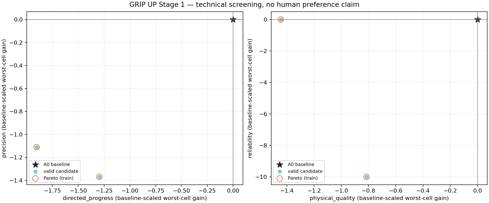

# GRIP UP — Relatório do Physics Auto-Tuning Lab v1.3

Data da experiência: 20 de outubro de 2026. Estado: piloto interrompido pela regra de regressão; sem candidato para integração.

## 1. Resultado e decisão

**Manter A0/B1. O piloto não demonstrou uma melhoria robusta e detetou uma regressão reproduzível no ensaio headless.** Das duas configurações propostas, nenhuma passou o critério de melhoria prática. A segunda perdeu a captura de destino em Swing & Catch; uma repetição com os mesmos parâmetros, seed e política confirmou a falha. A pesquisa parou conforme a regra definida antes dos resultados.

Há uma limitação importante: na revisão nativa em tempo real, a própria referência A0/B1 também falhou essa captura. Portanto, a regressão está demonstrada para a configuração headless medida, mas a diferença entre referência e candidato não foi reproduzida nos dois modos. A consistência do ensaio de captura precisa de investigação antes de uma nova pesquisa. Não há evidência de melhoria de feel, preferência humana ou generalização.

| Configuração | Decisão de produto | Fundamentação |
|---|---|---|
| A0/B1 atual | **KEEP como referência** | Preserva a experiência existente; não apareceu uma alternativa sustentada pelos dados. Não significa que A0 seja ótimo. |
| Random 1 — `e8941a99a5f7` | **REJECT para adoção** | Mantém 6/7 metas headless, mas piora os quatro objetivos ou empata com a referência; não demonstra ganho robusto. |
| Random 2 — `d2b9bedb66c9` | **REJECT para adoção** | 5/7 metas em duas execuções headless; falha de contacto real na captura de destino. |
| Avaliador, para uma futura pesquisa | **REVISE** | Investigar a discrepância headless/nativo da captura e melhorar a cobertura de paragem e de travessia lateral. Nenhuma revisão foi aplicada depois de observar o estudo. |

A shortlist congelada contém **zero candidatos**. TPE, sensibilidade, validação de finalistas a 60/120 Hz e resultados de holdout não foram executados. Não se promoveu qualquer configuração, nem se iniciou RL ou M7.

## 2. O que ficou implementado

O laboratório é uma ferramenta offline separada do arranque normal. Python propõe quatro valores; o Godot executa o controlador existente e devolve observações. O jogador continua a escolher pegas e a controlar o movimento no jogo. As políticas automáticas são drivers de ensaio explícitos, não um agente que joga o nível pelo utilizador.

| Componente | Implementação e limite |
|---|---|
| Registo de parâmetros | IDs, campos reais, unidades, referências, intervalos, invariantes e proveniência em `parameter_space.json`. |
| Transporte de configuração | Candidato completo, tipado, limitado, quantizado a oito casas decimais e identificado por SHA256 canónico. Valores desconhecidos, parciais, não finitos ou inseguros são rejeitados. |
| Overrides | Duplicação do Resource por sessão, instalação antes do primeiro passo físico e reposição do Resource original; sem escrever valores nas definições do jogo. |
| Avaliação Godot | Sete episódios de treino, quatro casos públicos de segurança e nove definições de validação reservada. Inputs comuns do jogo, contacto e retenção reais, métricas e rastos limitados. |
| Runner Python | Manifesto anterior à execução, diretório único, timeout, captura de stdout/stderr, validação de resultados e hashes, classificação de falhas e um único worker. |
| Pesquisa | Optuna com SQLite, Random com seed, TPE condicionado aos gates, quatro objetivos separados e arquivo Pareto. |
| Validação posterior | Shortlist imutável, repetição a 60/120 Hz e acesso aos holdouts condicionado à validação anterior. Implementado, mas não acionado neste piloto. |
| Análise | CSV com métricas brutas, distribuições, piores casos, gráfico Pareto e ferramenta de perturbação de um parâmetro de cada vez. A ferramenta de sensibilidade não foi executada. |
| Revisão nativa | Cena isolada acionada pelo Godot MCP Pro, execução em tempo real no monitor 1, resultados JSON e capturas PNG; identificada como scripted. |
| Protocolo humano | A/B equilibrado, oito avaliações separadas, preferência e confiança. Documento preparado; zero sessões realizadas. |

A avaliação mantém separados: execução do teste e conclusão da tarefa; seleção, contacto e retenção; apoio real e alvo pendente; movimento físico e top-out híbrido assistido. O First Ascent fecha a janela de métricas do controlador quando começa a assistência e regista percursos do COM por fase. A rota reservada não foi executada.

## 3. Código e mecânica preservados

O checkpoint anterior é `f865ebf3a95eac983329d43df1a90dd1b7952bbd`, tag `baseline/pre-v1.3-auto-tuning`. O código da experiência foi congelado em **`1b0a86272a2939452dbe14130df25cde40278a82`**, com o repositório limpo. As versões posteriores deste relatório não alteram essa identidade experimental.

O [freeze AT0](baseline/freeze.json) protege 202 ficheiros existentes de gameplay, recursos, cenas e modelos. Foram conservados o grabber original de Janga e o executável anterior. O manifesto público de cada execução enumera 239 dependências por hash; os ficheiros reservados de holdout ficam fora desse conjunto de treino.

| Grandeza congelada | Valor |
|---|---:|
| Massa do corpo | 12 kg |
| Alcance máximo de aquisição | 0,65708 m |
| Força total das mãos | 360 N |
| Força dos pés | 180 N total; 120 N por pé |
| Assistência angular partilhada | 20 N·m |
| Momento combinado máximo | 150 N·m |
| Spring / amortecimento do atuador | 6000 N/m / 220 N·s/m |
| Aceleração virtual / horizonte | 1 m/s² / 0,18 s |
| Envelope do planeador | 0,055 m |

Não se alteraram gravidade, colisores, alcance anatómico, limites de força/torque, integridade das pegas, solver Jolt ou geometria para favorecer candidatos. O controlo negativo A1 não serviu de seed; B2 não participou na pesquisa. A comparação seleciona explicitamente perfil 4, A0 e pés físicos B1; o arranque normal continua no perfil 2.

O invariant de ausência de escrita direta no corpo tem um âmbito explícito: auditoria estática, whitelist e identidade do código. **Não é um intercetor de todas as atribuições de transform em runtime.** Os limites de forças, contactos, estados finitos, alvos pendentes e exclusividade de autoridade são verificados nas observações de execução. A colocação inicial de fixtures e a fase híbrida autorizada têm tratamento separado.

## 4. Espaço de pesquisa e configurações efetivamente medidas

| Campo | Unidade | A0 | Intervalo aprovado | Random 1 | Random 2 |
|---|---|---:|---:|---:|---:|
| `traversal_speed_m_s` | m/s | 0,25 | 0,18–0,32 | 0,31517140 | 0,20661109 |
| `traversal_input_ramp_s` | s | 0,12 | 0,07–0,20 | 0,15155457 | 0,10353623 |
| `traversal_target_max_rate` | m/s | 0,24 | 0,16–0,30 | 0,16878390 | 0,18401690 |
| `traversal_target_max_acceleration` | m/s² | 0,90 | 0,60–1,20 | 0,79564940 | 1,17263832 |

O acoplamento exige `rate² / (2 × acceleration) ≤ 0,055 m`; a rampa abrange pelo menos quatro passos a 60 Hz. Estes limites foram aprovados para o experimento; não estabelecem que todas as combinações excluídas sejam impossíveis ou instáveis.

Os quatro parâmetros variaram em simultâneo. Como a paragem aconteceu antes da sensibilidade, não se pode atribuir causalmente o resultado a um parâmetro isolado.

## 5. Plano, contagens e motivo de paragem

Configuração: `stage1_r1`, `train_tape_r3`, revisão 3, física a 120 Hz, seed de proposta 104729, seed de execução 101, um worker, timeout de 180 s por execução. Cada avaliação percorre os mesmos sete episódios por ordem fixa, com mundo novo por episódio. O contexto do processo/Jolt e a ordem fazem parte da experiência.

| Etapa | Previsto | Realizado |
|---|---:|---:|
| Repetições A0/B1 | 3 | 3 |
| Propostas Random | Até 12, sujeito a gates | 2 |
| Confirmação de regressão | Quando necessária | 1, do Random 2 |
| Propostas TPE | Até 40, condicionais | 0 |
| Shortlist | Até 5 elegíveis | 0 |
| Sensibilidade local | Ferramenta disponível | 0 execuções |
| Repetição de finalistas a 60/120 Hz | Condicionada à shortlist | 0 |
| Holdout / A/B humano | Etapas posteriores | 0 / 0 |

O piloto contém **seis execuções do avaliador e 42 episódios**. Todas as seis execuções devolveram `completed`: isso significa que a avaliação foi executada, não que todas as metas foram atingidas. Houve **34 metas atingidas e oito falhadas**. Não houve candidatos inválidos, crashes, timeouts, rejeições por invariant ou métricas ambíguas nestas seis execuções. As falhas de tarefa permanecem nos resultados.

O Random 2 devolveu `NO_REAL_CATCH`: o alvo de destino foi selecionado, mas não houve contacto nem retenção. Não foi uma pega ilegal, nem uma pega estabelecida que depois se soltou. A referência headless conseguira contacto real e retenção em 3/3 repetições; o candidato falhou nas duas execuções, incluindo a confirmação.

Motivo literal guardado: `reproduced essential regression: lost baseline task completion: swing_catch_train`. Os limites de pesquisa são máximos condicionais; não se completaram artificialmente as contagens depois da paragem.

## 6. Resultados por cenário e variabilidade

Valores em metros: deslocamento final do COM projetado na direção declarada, com sinal. São resultados das fitas específicas. As metas de hang e catch dependem de apoio/contacto/retenção, não de deslocamento positivo por si só.

| Cenário | A0: média ± SD; pior, n=3 | Metas A0 | Random 1, n=1 | Random 2: média; pior, n=2 | Metas R1 / R2 |
|---|---:|---:|---:|---:|---:|
| Vertical Pull | 0,19808 ± 0; 0,19808 | 3/3 | 0,17240 | 0,16036; 0,16036 | 1/1 / 2/2 |
| Asymmetric Pull | 0,17905 ± 0; 0,17905 | 3/3 | 0,17106 | 0,15273; 0,15273 | 1/1 / 2/2 |
| Lateral Traverse | −0,06679 ± 0; −0,06679 | 0/3 | −0,06447 | −0,03594; −0,03594 | 0/1 / 0/2 |
| One-hand Hang | −0,00567 ± 0; −0,00567 | 3/3 | −0,00298 | −0,02328; −0,02328 | 1/1 / 2/2 |
| Swing & Catch | 0,40555 ± 0; 0,40555 | 3/3 | 0,44241 | 0,17970; 0,17970 | 1/1 / 0/2 |
| Foot-supported Step | 0,25462 ± 0; 0,25462 | 3/3 | 0,24641 | 0,23516; 0,23516 | 1/1 / 2/2 |
| Ground → Grip | 0,23044 ± 0; 0,23044 | 3/3 | 0,21627 | 0,19334; 0,19334 | 1/1 / 2/2 |

As três repetições A0 deram métricas iguais nesta seed e modo headless. O Random 2 e a confirmação também coincidiram; a SD observada é zero. Isto demonstra repetibilidade local, não ausência geral de variabilidade. O Random 1 tem só uma execução: não há estimativa de dispersão própria. Os valores exatos, métricas adicionais e distribuições estão no [CSV por cenário](reports/stage1_r1/scenario_metrics.csv) e no [resumo estruturado](reports/stage1_r1/summary.json).

O lateral manteve duas mãos presas, iniciou sem apoio nativo do chão e não apresentou contacto/autoridade nativa de chão na medição. O progresso negativo é um resultado válido da fita: a fase pendular deixada pela preparação não foi vencida antes do contracomando. **Nenhuma configuração completou a meta lateral.** Uma redução do valor negativo não equivale a uma travessia bem-sucedida.

Exemplos de compromisso: Random 1 aumenta o deslocamento do catch de 0,40555 para 0,44241 m, mas reduz a subida vertical e aumenta a sua latência de 0,60833 para 0,69167 s. O twist lateral sobe de 0,11915 para 0,16245 rad RMS. Random 2 reduz a magnitude do desvio lateral e mede reversão de 0,125 s contra 0,14167 s de A0, mas perde a captura e reduz o progresso nos restantes ensaios direcionais. Estes efeitos locais não constituem uma melhoria geral.

## 7. Quatro objetivos e arquivo Pareto

Cada objetivo usa o pior ganho entre as suas células. A escala é o máximo entre piso prático declarado, 10% da magnitude da média A0 e duas SD da referência. Progresso, precisão, qualidade física e fiabilidade são mantidos separados; não existe uma soma que permita compensar uma violação física com velocidade.

| Configuração | Progresso | Precisão | Qualidade física | Fiabilidade | Melhoria prática elegível |
|---|---:|---:|---:|---:|---|
| Referência relativa A0 | 0 | 0 | 0 | 0 | Referência |
| Random 1 | −1,2963 | −1,3699 | −1,4435 | 0 | Não |
| Random 2 | −1,9039 | −1,1111 | −0,8151 | −10 | Não |

O critério de seleção exige todos os eixos ≥ −0,25, pelo menos um ≥ 1 e nenhuma regressão essencial. Os dois candidatos falham. **A0 domina ambos neste espaço de objetivos.**



O arquivo Pareto e os círculos laranja calculam a fronteira **entre propostas**, sem incluir A0 como candidato. Por isso mostram as duas propostas não dominadas entre si; não indicam superioridade face à referência. A shortlist aplica ainda o gate de melhoria prática e ficou vazia. O [relatório técnico gerado](reports/stage1_r1/report.md) deve ser lido com esta distinção.

## 8. Revisão nativa com Godot MCP Pro

Foram reproduzidos A0 e Random 2 em cena isolada, no monitor 1, com renderização em tempo real e sem `--fixed-fps`. São duas demonstrações scripted adicionais, fora das seis execuções do piloto. Não são sessões humanas A/B.

| Configuração / modo, 120 Hz | Metas | Catch | Progresso do catch |
|---|---:|---|---:|
| A0 headless, três repetições | 6/7 em cada | Contacto e retenção em 3/3 | 0,40555 m |
| A0 nativo, uma execução | 5/7 | `NO_REAL_CATCH` | 0,19213 m |
| Random 2 headless, proposta + confirmação | 5/7 em cada | `NO_REAL_CATCH` em 2/2 | 0,17970 m |
| Random 2 nativo, uma execução | 5/7 | `NO_REAL_CATCH` | 0,17960 m |

Nos dois nativos, as flags de violação de invariantes ficaram `false` e as verificações de reposição passaram. A discrepância do catch A0 permanece **sem causa isolada demonstrada**. Não se atribui a Jolt, framerate ou input sem um diagnóstico controlado. Não se ajustaram a fita, geometria, tolerâncias ou parâmetros para eliminar a diferença. O piloto continua a justificar não adotar os candidatos; não estabelece uma vantagem de captura consistente entre modos.

Evidência: [resultado nativo A0](native/baseline_120_r1/result.json), [resultado nativo Random 2](native/random_0002_120_r1/result.json), [imagem do lateral A0](native/baseline_120_r1/frame_03.png) e [imagem do catch Random 2](native/random_0002_120_r1/frame_05.png). Existem sete PNG por execução; são amostras visuais, não vídeo contínuo.

O MCP listou quatro avisos de análise de GDScript no laboratório: três `INCOMPATIBLE_TERNARY` e um `INTEGER_DIVISION`, guardados nos recibos de diagnóstico. A cena executou e produziu resultados; não se apresenta essa revisão como livre de avisos. O rótulo de diagnóstico sobrepõe parte do texto da cena. Não se alterou o código congelado para corrigir apresentação depois da experiência.

Depois da revisão, o modo normal foi restaurado e inspecionado pelo MCP: perfil 2, A0, 120 Hz, hold-to-grip, valores 0,25 / 0,12 / 0,24 / 0,90, observer e gravadores desligados, sem driver de pesquisa. O [recibo de runtime](native/normal_startup_runtime.txt) guarda estes valores; o [diagnóstico normal](native/normal_startup_diagnostics.txt) devolveu zero entradas.

## 9. Testes e cobertura efetiva

| Verificação | Evidência e resultado | Âmbito |
|---|---|---|
| Regressão da referência existente | 24 execuções, 884 checks, zero falhas nos checks executados | Física, contacto pendente, intenção/reversão, chão, sinais de referência, rotas, híbrido/vault e pés; 60/120 Hz. |
| Invocações iniciais incorretas | Quatro falhas de chamada preservadas | Dois nomes de scripts inexistentes a duas frequências; chamadas corrigidas. Não foram falhas de simulação nem se afirma que todas as invocações iniciais passaram. |
| Contratos Python | 32 testes passaram | Schema, transporte, subprocessos, falhas, proveniência, gates e SQLite/Optuna. Dados sintéticos desses testes não são resultados de gameplay. |
| Loader / resposta / catálogo | 30 / 17 / 13 checks passaram | Isolamento de Resource, métricas numéricas e rejeição de pedidos inválidos. Catálogo reservado apenas validado como estrutura. |
| Timeout First Ascent | 11 checks a 60 e 120 Hz | Wrapper real, deadline e cleanup; zero frames de rota avançados e nenhum resultado reservado consultado. |
| Segurança pública | 4/4 casos a 60 e 120 Hz | Ar sem mãos, pendente/cancelamento, pés OFF e handoffs reais. Smoke anterior à pesquisa, com os hashes próprios arquivados. |
| Smoke de transporte `.26` | 7 episódios a cada frequência | Override conhecido com efeitos mistos; não é finalista nem proposta vencedora. |
| Piloto congelado | 6 execuções / 42 episódios a 120 Hz | Dois candidatos e uma confirmação; zero hard violations observadas. |
| Nativo | 2 execuções / 14 episódios a 120 Hz | 10 metas atingidas; discrepância de captura preservada. |

Recibos: [regressão de referência](reference_index.json), [contratos finais combinados](contracts/attempt_002/results.json), [timeout](baseline_smoke/timeout_contract_120hz.json) e [revisão física pré-pesquisa](physics_review.md).

Os 16 tópicos de robustez da spec têm cobertura distribuída entre testes antigos, contratos novos e cenários de validação implementados. **Não foram todos repetidos com cada candidato.** Faltam resultados de candidatos em espelhos, nova câmara, suporte dinâmico, canary A1 e First Ascent reservado. A cobertura antiga não substitui essa validação. O código privado existe, mas só o schema/parser foi verificado; nenhum resultado físico de holdout foi aberto.

### Comparação preliminar entre frequências

Estes valores são do smoke pré-pesquisa, uma execução por condição, não uma distribuição de finalistas:

| Cenário | A0 120 / 60 Hz, m | Override conhecido `.26` 120 / 60 Hz, m |
|---|---:|---:|
| Vertical | 0,19808 / 0,18777 | 0,20262 / 0,19219 |
| Assimétrico | 0,17905 / 0,17030 | 0,18143 / 0,17453 |
| Lateral | −0,06679 / −0,06476 | −0,07246 / −0,06085 |
| Hang | −0,00567 / 0,10068 | −0,00580 / 0,13140 |
| Catch | 0,40555 / 0,67646 | 0,40206 / 0,69751 |
| Step | 0,25462 / 0,25061 | 0,25582 / 0,25191 |
| Ground → Grip | 0,23044 / 0,19288 | 0,23214 / 0,19544 |

As metas foram 6/7 nas quatro condições; o lateral falhou em todas. A magnitude do catch e a trajetória do hang variam com a frequência. Não houve validação a 60 Hz dos Random 1/2, nem demonstração de equivalência entre frequências.

## 10. Limitações das métricas e riscos de interpretação

- **Precisão:** `overshoot_m` mede excursão além do corredor de meta durante toda a fita, inclusive enquanto o comando continua pressionado. Não mede isoladamente movimento indesejado depois de travar; maior progresso comandado pode piorar esta métrica.
- **Paragem:** `stop_distance_m` ficou `null` em todos os cenários. A janela não encontrou a condição contínua de baixa velocidade durante 0,25 s, ou o primeiro stop foi interrompido. Não há distância de paragem zero nem prova de travagem precisa.
- **Latência:** mede resposta depois do input aceite pelo coordenador. Não mede a latência física do rato/ecrã. A reversão só ficou disponível no lateral.
- **Swing:** o hang usa apoio real, amplitude pendular e trabalho por fase. No smoke A0, a fase COUNTER também injeta trabalho positivo considerável; o proxy não prova travagem forte ou universal. Não se penaliza toda a rotação como erro.
- **Pés:** B1 está ligado e carrega peso, incluindo no hang e catch. Uma mão agarrada não significa suspensão exclusivamente pelos braços. As subidas vertical/assimétrica começam no chão e incluem transição de apoio.
- **Energia e jerk:** trabalho de contactos é parcial; não prova conservação da energia total. O jerk reportado dos alvos é derivado da aceleração com a mesma âncora; não é jerk do corpo limpo de colisões. Fases híbridas não entram como escalada puramente dinâmica.
- **Variabilidade e causalidade:** três repetições na mesma seed não cobrem diversidade de posturas, máquinas, câmaras ou utilizadores. O desvio nativo do catch impede extrapolar a repetibilidade headless. Não se fez sensibilidade nem análise causal dos quatro knobs.
- **Benchmark:** a versão r2 contava caminhada no chão como ganho lateral. Essa evidência foi preservada como benchmark contaminado; o treino r3 exige apoio aéreo real e conserva o resultado negativo. Não se reutilizou o aparente ganho r2.
- **Humano:** não existem avaliações de conforto, fadiga, diversão, preferência ou aprendizagem nesta entrega. A interface v1.2 tem sete ratings diferentes; não foram reinterpretados como as oito perguntas da v1.3.

## 11. Estado dos milestones

| Etapa | Estado desta entrega | Gate |
|---|---|---|
| AT0 — Audit/freeze | Concluído para o piloto | Referência recuperável e hashes guardados. |
| AT1 — Overrides | Implementado e testado | Quatro campos, bounds, sessão e reposição. |
| AT2 — Avaliador | Implementado e exercitado; limitações registadas | Transporte consistente; catch nativo/headless e cobertura de paragem requerem revisão antes de expandir. |
| AT3 — Baseline/Random | Executado e interrompido pelo gate | 3 referências, 2 propostas, 1 confirmação. |
| AT4 — TPE/Pareto | Pareto calculado; TPE não executado | Sem melhoria prática elegível; regressão confirmada. |
| AT5 — Generalização | Infraestrutura disponível; não executado para candidatos | Shortlist vazia; sem resultados reservados. |
| AT6 — A/B humano | Protocolo preparado; não realizado | Zero sessões; não pode receber PASS automático. |
| AT7 — Integração | Não realizada | Nenhum candidato aprovado. |
| RL0 / M7 | Fora desta experiência | Não iniciados. |

O laboratório entrega infraestrutura e um resultado negativo auditável. Não conclui todas as etapas de aceitação de uma nova locomoção. Antes de outra pesquisa, a prioridade é diagnosticar a consistência do catch, definir ensaios próprios de stop/correção e rever a utilidade do lateral sem esconder a falha atual. Isso exige uma nova versão do avaliador e um novo estudo; não foi executado como parte deste relatório.

## 12. Reprodução, ficheiros e hashes

Engine observado: `4.7.2.stable.steam.ed1daf0bf`, backend Jolt integrado. SHA256 do executável: `12310c74bdda7dcd43f28e971f33047dcecadd436b68169d61ce41009006df38`. Dependências locais fixadas: Python 3.13.13, Optuna 5.0.0, Matplotlib 3.10.8. O ambiente Python não faz parte do runtime do jogo.

| Artefacto | Identidade |
|---|---|
| Código da experiência | `1b0a86272a2939452dbe14130df25cde40278a82` |
| Driver Godot | `19d2f0b93cbf3501dfd05c02d0d46da958cde3307c62b015db254a978f6b2713` |
| Fita pública r3, bytes do ficheiro | `67c9af636ba97c55846e86d8992e46ed04d2bcdb2153ec9b23dfe1161f25c553` |
| Registo de parâmetros, bytes do ficheiro | `aec7e3be5e22fa9185cedc1e0e9bd1bfbf8d101205da69d732294e072a959e2b` |
| Backup Windows anterior | `fb018cfbf8ac57dac83c43af6590f2107bede466d56053e1218583f03564e33d` |
| Grabber original Janga | `8ab923ac1d903e8dcc8ed2a2e4f9f8c5cec326a3217cb4a9d8f00036557e7dad` |

O [arquivo integral do estudo](evidence/stage1_r1.zip) contém 49 ficheiros: candidatos, manifestos, resultados brutos e validados, stdout/stderr, eventos, SQLite, referências, Pareto e shortlist. SHA256 do ZIP: `c583f9034ce9dbf76f34cb936914436cb30613efa28b56588fe4a42fb96d2c40`. O [manifesto de arquivo](evidence/stage1_r1_manifest.json) enumera tamanho e SHA256 de cada membro; a leitura integral de retorno foi verificada. Falhas não foram removidas. O ZIP inclui o estado final interrompido, não um estudo preparado para continuar a pesquisar. A [verificação final](final_verification.json) confere o relatório, arquivo, resultados, hashes das duas cópias e recibo de reposição do modo normal, sem executar novos ensaios.

Os caminhos absolutos históricos nos manifestos documentam a execução local; os CSV e o ZIP permitem consultar a evidência sem recriar essas pastas. A identidade canónica do registo JSON e o hash dos bytes do ficheiro são conceitos distintos e têm nomes separados no manifesto.

Para uma reprodução nova, usar um checkout limpo do commit experimental, o engine registado e os caminhos de `tools/project_config.py` adequados ao ambiente. Na configuração local, executar a partir da raiz do projeto:

```powershell
uv sync --frozen --project tools/auto_tuning
uv run --frozen --project tools/auto_tuning python -m unittest discover -s tools/auto_tuning/tests -v
uv run --frozen --project tools/auto_tuning python tools/auto_tuning/optimize.py --baseline-only --output builds/auto_tuning/reproduction_r1
uv run --frozen --project tools/auto_tuning python tools/auto_tuning/optimize.py --output builds/auto_tuning/reproduction_r1
uv run --frozen --project tools/auto_tuning python tools/auto_tuning/report.py --study builds/auto_tuning/reproduction_r1 --output docs/validation/auto_tuning/reports/reproduction_r1
uv run --frozen --project tools/auto_tuning python tools/auto_tuning/shortlist.py --study builds/auto_tuning/reproduction_r1 --output builds/auto_tuning/reproduction_r1/shortlist.json --top 5
```

Estes comandos são instruções de reprodução, não uma pesquisa adicional feita para este relatório. Escolher um diretório novo; nunca misturar resultados de códigos diferentes. O resume exige a mesma revisão, estado Git, hashes, engine, configuração e versões. Alterações de fim de linha também podem alterar hashes de bytes. Um checkout noutra revisão, mesmo que só acrescente documentação, não deve ser apresentado como a identidade histórica original.

Mais comandos de repetição, validação reservada, sensibilidade e replay estão no [README técnico](../../../tools/auto_tuning/README.md). As etapas posteriores dependem dos gates; a shortlist histórica vazia não permite abrir validação física reservada. O [protocolo humano](human_protocol.md) permanece disponível para uma futura configuração elegível.

A configuração de exportação exclui o laboratório, ferramentas, documentação e dependências da pesquisa. Não foi gerado um novo executável de jogo nesta fase; conserva-se o backup anterior. Esta entrega termina no relatório e na evidência, mantendo a locomoção existente.
